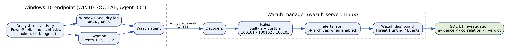
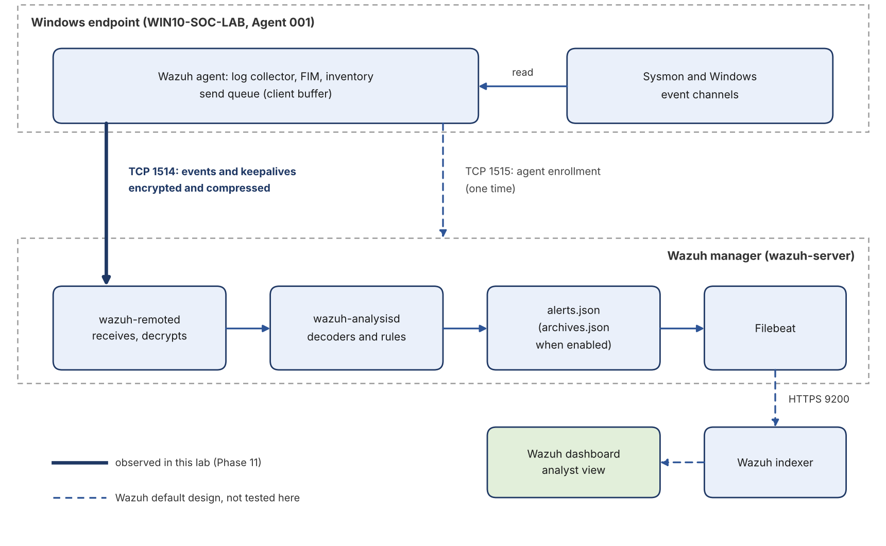

# Wazuh SOC L1 Detection & Investigation Lab

An evidence-based **SOC Level 1 lab** built on **Wazuh 4.14.7**, **Sysmon** and a **Windows 10** endpoint. It follows the real analyst workflow, from endpoint telemetry to alert to investigation to verdict, and is documented in **11 phases** with 60+ figures and screenshots.

> **Core principle:** an alert is a starting point for investigation, not proof of an attack.

**Full report:** [`report/Wazuh-SOC-L1-Final-Report.pdf`](report/Wazuh-SOC-L1-Final-Report.pdf) (88 pages) &nbsp;|&nbsp; **Documentation:** [`docs/`](docs/) &nbsp;|&nbsp; **Rules:** [`rules/`](rules/)

---

## Highlights

| | |
|---|---|
| Phases completed | 11 |
| Custom detection rules | 3 (2 confirmed working, 1 documented as unresolved) |
| MITRE ATT&CK techniques mapped | 11, graded as detection, telemetry or reasoning |
| Evidence | 60+ figures and screenshots, each tied to a claim |
| Environment | Wazuh 4.14.7 manager (VirtualBox VM), Windows 10 Pro endpoint, Sysmon |

## Architecture



How an event gets from the endpoint to the analyst (agent to manager on TCP 1514, see [docs/02](docs/02-lab-environment.md)):



## Phases

| Phase | Topic | What was done | Document |
|---|---|---|---|
| 1 | Wazuh fundamentals | Architecture, event vs alert, investigation method, two investigations | [docs/03](docs/03-phase-01-wazuh-fundamentals.md) |
| 2 | Windows, Sysmon and PowerShell | Key event IDs, correlation of process, file, DNS and network telemetry | [docs/04](docs/04-phase-02-windows-sysmon-powershell.md) |
| 3 | Detection engineering | Wrote and debugged custom rules 100101 and 100102, persistence hunt | [docs/05](docs/05-phase-03-detection-engineering.md) |
| 4 | Process investigation | Process tree, encoded PowerShell hunt, Events 1, 11 and 22 correlated by ProcessGuid | [docs/06](docs/06-phase-04-process-investigation.md) |
| 5 | Authentication hunting | Failed (4625) then successful (4624) logons read as one timeline | [docs/07](docs/07-phase-05-authentication-hunting.md) |
| 6 | Network monitoring | Sysmon Event 3, DNS correlation, troubleshooting custom rule 100103 (unresolved) | [docs/08](docs/08-phase-06-network-monitoring.md) |
| 7 | MITRE ATT&CK mapping | Evidence-based mapping and detection validation | [docs/09](docs/09-phase-07-mitre-attack-mapping.md) |
| 8 | Rule review | Event-to-alert pipeline, rule hierarchy, live rule file compared with documentation | [docs/10](docs/10-phase-08-detection-engineering-review.md) |
| 9 | Alert validation | A real rule 100102 alert investigated end to end, evidence gap recorded | [docs/11](docs/11-phase-09-alert-validation.md) |
| 10 | File integrity monitoring | File added, modified and deleted; hashes cross-checked independently | [docs/12](docs/12-phase-10-file-integrity-monitoring.md) |
| 11 | Vulnerability detection | High-severity 7-Zip finding confirmed, patched and verified closed; stale inventory investigated | [docs/13](docs/13-phase-11-vulnerability-detection.md) |

Reference chapters: [custom rules](docs/14-custom-rules-reference.md), [commands](docs/15-commands-reference.md), [key lessons](docs/16-key-lessons.md), [MITRE ATT&CK coverage](docs/17-mitre-attack-coverage.md), [detection catalogue](docs/18-detection-catalogue.md), [sample incident report](docs/19-sample-incident-report.md), [evidence index](docs/20-evidence-index.md), [limitations and future work](docs/21-limitations-and-future-work.md). "Section N" in the documents refers to `docs/NN-...`.

## Custom detection rules

| Rule | Level | Purpose | Status |
|---|---|---|---|
| 100101 | 10 | PowerShell spawned by `cmd.exe` | Confirmed working |
| 100102 | 10 | Scheduled task created with `schtasks.exe /create` (T1053.005) | Confirmed working |
| 100103 | 8 | PowerShell initiated a TCP connection (Sysmon Event 3) | **Unresolved**: no matching alert verified |

[`rules/local_rules.live.xml`](rules/local_rules.live.xml) is the file as captured in the lab. [`rules/local_rules.hardened.proposed.xml`](rules/local_rules.hardened.proposed.xml) holds hardened versions suggested by the Phase 8 review; they are **proposed, not deployed and not tested**.

## Skills demonstrated

- Alert triage and evidence-based verdicts
- Sysmon and Windows event analysis (Events 1, 3, 11, 22, 4624, 4625)
- Detection engineering: Wazuh rules, PCRE2, rule hierarchy, MITRE tags, rule review
- Event correlation with ProcessGuid and timelines
- File integrity monitoring and hash verification
- Vulnerability triage, remediation and verification
- Agent health, inventory and connectivity troubleshooting
- Technical writing that separates observed facts from hypotheses

## What this project does not claim

- No real attack or malware was analysed. All activity was generated by the author in an isolated lab.
- The detections have not yet been tested against adversary-simulation tooling.
- Rule 100103 never produced an alert, and several open items are recorded openly. See [limitations and future work](docs/21-limitations-and-future-work.md).
- Hypothetical exercises are labelled as hypothetical.

## Repository structure

```text
wazuh-soc-l1-lab/
├── README.md
├── report/        final report (PDF)
├── docs/          one document per phase, plus reference chapters
├── rules/         custom rule files (live and proposed)
├── screenshots/   evidence, one folder per phase
└── images/        diagrams used in the documentation
```

## Lab environment

| Item | Value |
|---|---|
| SIEM | Wazuh 4.14.7 (manager `wazuh-server` in a VirtualBox VM) |
| Endpoint | Windows 10 Pro, agent `WIN10-SOC-LAB` (ID 001) |
| Telemetry | Sysmon, Windows Security log, Wazuh FIM and Syscollector |
| Agent to manager | TCP 1514 |

User, host and folder names in screenshots are redacted. Run any test from this repository only in your own isolated lab.

## Author

**Waqar Ahmad**, BS Computer Science (Cybersecurity) student at the University of Buner, working towards a SOC Analyst role.

## License

Documentation and rules are released under the [MIT License](LICENSE).
