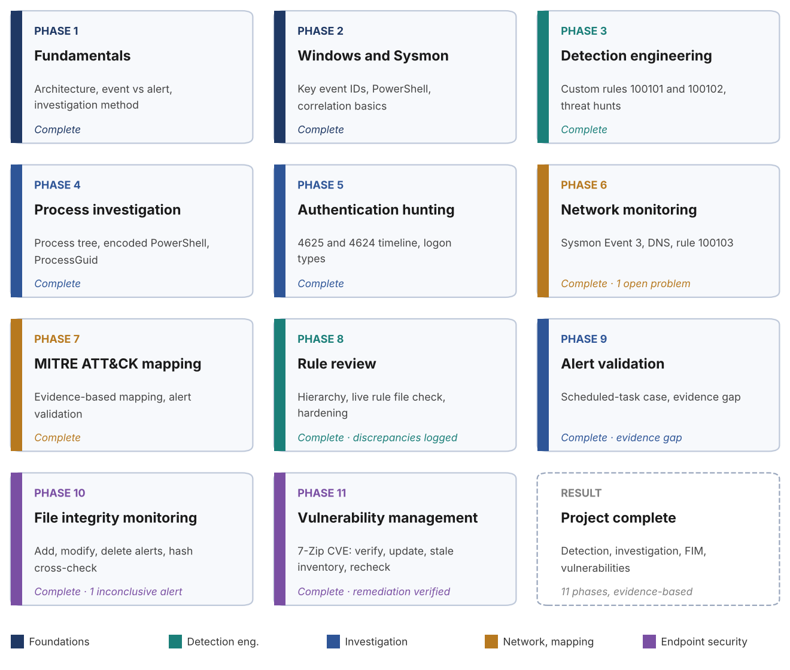

# 1. Project Overview

This project documents a hands-on SOC Level 1 lab built around Wazuh. The goal was not to click through a dashboard, but to practise the real analyst workflow: collect endpoint telemetry, understand how Wazuh turns events into alerts, investigate those alerts using evidence, and write custom detections.

The core mindset of the project: **an alert is a starting point for investigation, not proof of an attack.**

The workflow practised throughout the lab:

    Windows Endpoint -> Sysmon -> Wazuh Agent -> Wazuh Manager -> Decoder -> Rules -> Alert
    -> SOC Investigation -> Evidence -> Verdict -> Response / Escalation

| **Phase** | **Focus**                                                                | **Outcome**                                                                                                                                          |
|------------------------|------------------------|------------------------|
| Phase 1   | Wazuh fundamentals and SOC investigation foundation                      | Understood architecture, event vs alert, and the investigation method; completed two investigations                                                  |
| Phase 2   | Windows, Sysmon and PowerShell investigation                             | Learned key event IDs and correlated process, file, DNS and network telemetry                                                                        |
| Phase 3   | Detection engineering and threat hunting                                 | Wrote and debugged two custom rules; hunted persistence; completed blind investigations                                                              |
| Phase 4   | Advanced process investigation, PowerShell hunting and event correlation | Reconstructed a process tree, hunted encoded PowerShell and correlated Events 1, 11 and 22 by ProcessGuid, documenting that Event 3 was not observed |
| Phase 5   | Windows authentication hunting and authentication correlation            | Investigated failed (4625) and successful (4624) logons in Wazuh and correlated them as one timeline instead of isolated alerts                      |
| Phase 6   | Network security monitoring: Sysmon Event 3 and custom rule troubleshooting | Read Event 3 network telemetry, correlated process and DNS evidence, and documented an unresolved custom rule (100103) |
| Phase 7   | MITRE ATT&CK mapping and detection validation | Verified Sysmon Event 3 collection and decoding, mapped events to ATT&CK only where evidence allowed, and documented why searches for rules 61605 and 100103 found no alert |
| Phase 8   | Advanced detection engineering | Reviewed the event-to-alert pipeline and rule hierarchy, analysed rules 100101 and 100102 (benign triggers, blind spots), compared the live rule file with the documentation, and recorded rule 100103 and the archive setting as unresolved |
| Phase 9   | Detection validation and SOC investigation | Investigated a real rule 100102 alert end to end, separated observed facts from inferences, and documented the missing execution evidence as an explicit gap instead of assuming an outcome |
| Phase 10  | File integrity monitoring (FIM) investigation | Verified Wazuh FIM on a controlled file: creation, modification and deletion were all detected, and the recorded sizes, timestamps and hashes were cross-checked; one older FIM alert was recorded as inconclusive |
| Phase 11  | Vulnerability detection and remediation | Investigated a High-severity 7-Zip finding (CVE-2026-48111), verified the installed version, updated the software, investigated a stale Wazuh inventory and confirmed the finding no longer appeared; the cause of the stale record is recorded as unproven |

*Figure 1.1: The eleven phases at a glance, grouped by skill area.*

## 1.1 Executive summary

**What was built.** A working SOC L1 detection and investigation lab: a Windows 10 endpoint with Sysmon and the Wazuh agent, reporting to a Wazuh 4.14.7 manager. Eleven phases cover fundamentals, Windows and Sysmon telemetry, detection engineering, process and PowerShell investigation, authentication hunting, network monitoring, MITRE ATT&CK mapping with detection validation, advanced detection engineering, an evidence-based alert investigation, file integrity monitoring, and vulnerability detection with remediation.

**What was achieved.**

-   Three custom detection rules written against real telemetry (100101, 100102, 100103); two verified working, one documented as unresolved.
-   Real troubleshooting recorded: a regex and a field-name bug found and fixed in rule 100102, validated with `wazuh-analysisd -t`.
-   Events correlated by ProcessGuid across Sysmon Events 1, 11, 22 and 3, and authentication events 4625 and 4624 read as one timeline.
-   File integrity monitoring validated end to end: a file was created, modified and deleted, and every alert was cross-checked against independent evidence (sizes, hashes, timestamps).
-   A full vulnerability-management cycle: a High finding was confirmed, fixed and verified closed in Wazuh, and a stale inventory record was investigated rather than ignored.
-   Verdicts written with evidence, using one framework: benign, suspicious, needs further investigation, confirmed malicious.
-   Honest reporting: missing telemetry, hypothetical scenarios and unresolved problems are labelled as such, never presented as results.

**What is not claimed.** No real attack or malware was analysed. All activity was generated by the author in an isolated lab. The detections have not been tested against adversary-simulation tooling yet.

## 1.2 Skills demonstrated

| **Skill** | **Where shown** |
|---|---|
| Alert triage and evidence-based verdicts | Phases 1, 3, 4, 5 |
| Sysmon and Windows event analysis (1, 3, 11, 22, 4624, 4625) | Phases 2, 4, 5, 6 |
| Detection engineering (Wazuh rules, PCRE2, rule hierarchy, MITRE tags, rule review) | Phases 3 and 8, Section 14 |
| Troubleshooting a detection that does not fire | Phase 3 (fixed), Phase 6 (open) |
| Event correlation (ProcessGuid, timeline) | Phases 4, 5, 6 |
| Network telemetry analysis (Sysmon Event 3 and DNS) | Phase 6 |
| File integrity monitoring and hash verification | Phase 10 |
| Vulnerability triage, remediation and verification | Phase 11 |
| Agent health and inventory troubleshooting | Phase 11 |
| Technical writing and honest reporting | Whole document |
