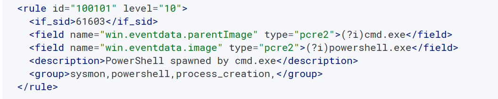
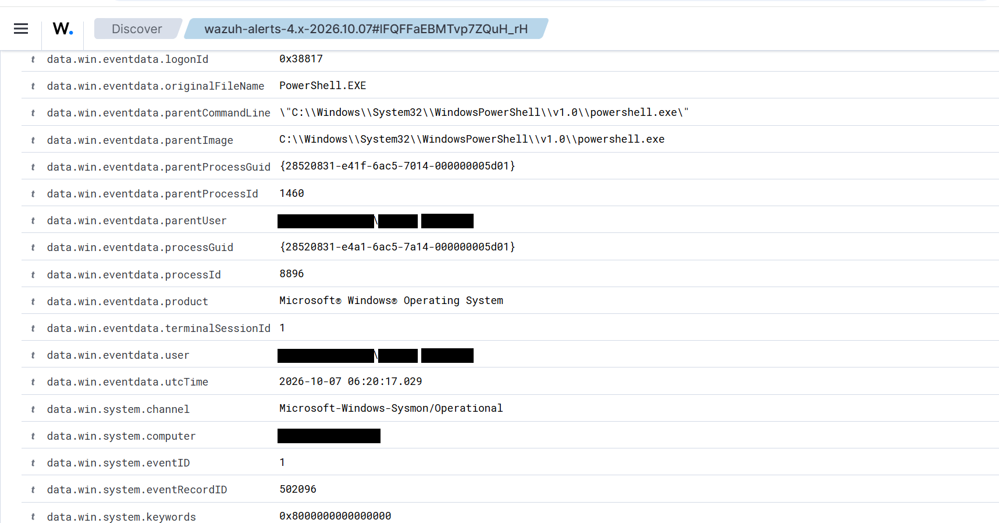
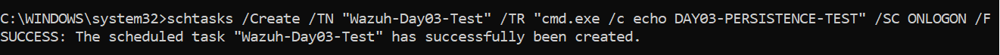
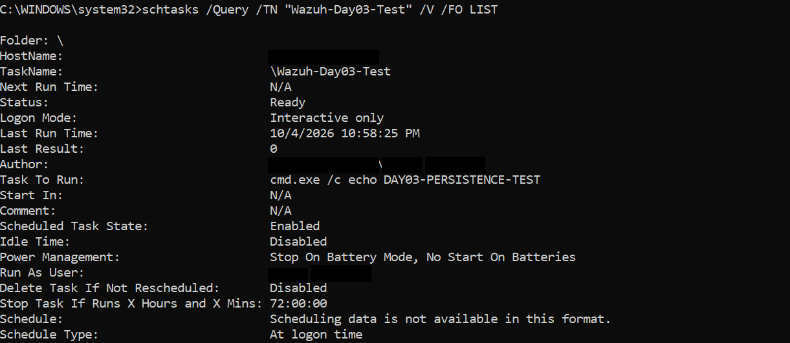
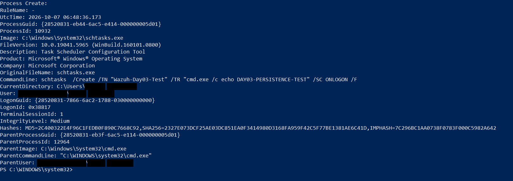
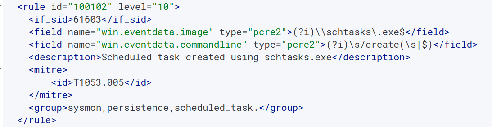
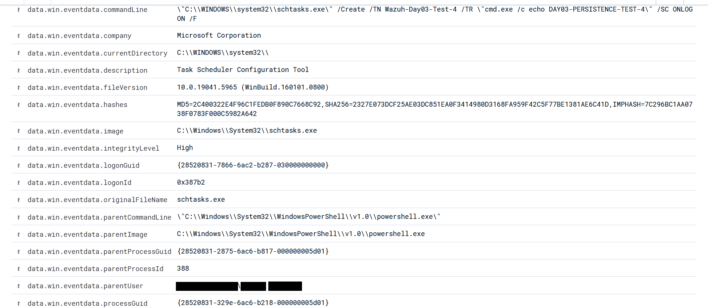
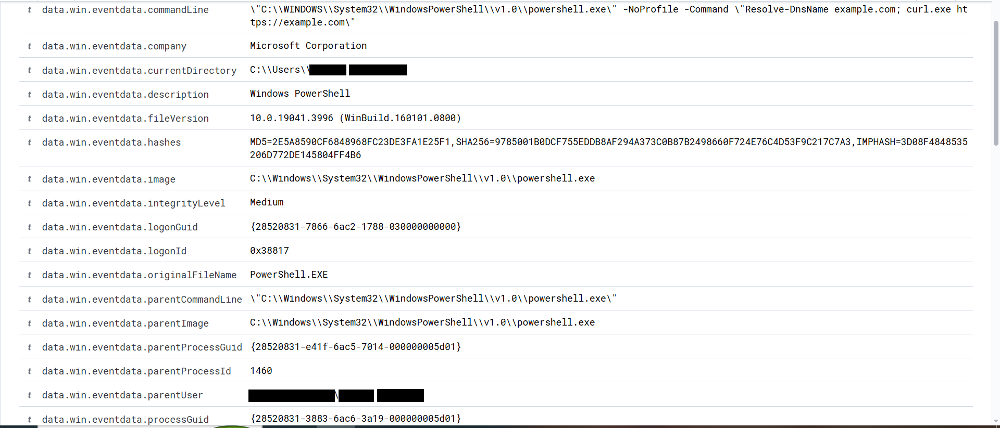
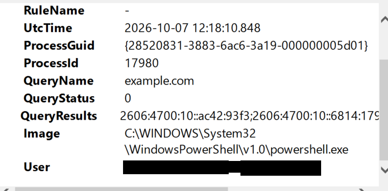

# 5. Phase 3: Detection Engineering and Threat Hunting

## 5.1 How custom rules build on built-in rules

    Sysmon Event -> Decoder -> Built-in Rule -> Custom Rule -> Alert

The `if_sid` option makes a custom rule evaluate only events that already matched a parent rule. The built-in parent used here was Rule 61603 (Sysmon Event 1, process creation):

    <rule id="61603" level="0">
      <if_sid>61600</if_sid>
      <field name="win.system.eventID">^1$</field>
      <description>Sysmon - Event 1: Process creation $(win.eventdata.description)</description>
      <options>no_full_log</options>
      <group>sysmon_event1,</group>
    </rule>

## 5.2 Custom Rule 100101: PowerShell spawned by cmd.exe

The rule only evaluates Sysmon Event 1 events (via 61603), requires the parent image to end with cmd.exe and the child image to end with powershell.exe, and raises a level 10 alert. The full XML is in Section 14 (Rule 100103 from Phase 6 is listed there too). **Note from Phase 8:** the live file uses looser patterns (`(?i)cmd.exe`, `(?i)powershell.exe`) than the description above; see Section 10.8.

*Figure 5.1: Custom rule 100101 as saved in the lab.*

## 5.3 Hunt: PowerShell parent-child relationship

Commands run:

    Get-Date
    Write-Host "DAY03-HUNT-TEST"
    powershell.exe -NoProfile -Command "Get-Date"

The third command produced **Rule 92027, Level 4: PowerShell process spawned PowerShell instance.** Child PID 8896, parent PID 1460, parent PowerShell, run by the interactive lab user.

**Verdict: Benign.** The alert fired because of the PowerShell-to-PowerShell parent-child relationship, not because `-NoProfile` is malicious.

*Figure 5.2: Sysmon Event 1 details in Wazuh Discover for the PowerShell-in-PowerShell alert: child PID 8896, parent PID 1460, parent image PowerShell.*

## 5.4 Persistence hunt and Rule 100102 (with troubleshooting)

A scheduled task was created in a controlled way to simulate a persistence technique:

    schtasks /Create /TN "Wazuh-Day03-Test" /TR "cmd.exe /c echo DAY03-PERSISTENCE-TEST" /SC ONLOGON /F

*Figure 5.3: The scheduled task was created successfully.*

*Figure 5.4: Task details from schtasks /Query: trigger At logon time, action cmd.exe /c echo DAY03-PERSISTENCE-TEST, status Ready.*

Sysmon recorded it as Event 1: image schtasks.exe, parent cmd.exe, High integrity, PID 2832 (the first test, Figure 5.5). Later tests ran the same command from other shells, so the parent differs between figures: Figure 5.7 belongs to a fresh test (task `Wazuh-Day03-Test-4`) started from PowerShell. **Wazuh did not generate the custom alert.** The investigation that followed:

1.  **Problem:** the first version of Rule 100102 never fired.
2.  **Root cause (regex):** the pattern expected `/create` to be followed immediately by `s` or the end of the string, but the real command was `/Create /TN ...` with a space after it.
3.  **Root cause (field name):** the rule used `commandline`, while the decoder writes the field as `commandLine`. (Phase 8 later found the lowercase spelling in the live file; whether the spelling matters is an open question, see Section 10.8.)
4.  **Fix:** corrected the pattern to `(?i)\s/create(\s|$)` and the field to `win.eventdata.commandLine`.
5.  **Validation:** checked the configuration with `sudo /var/ossec/bin/wazuh-analysisd -t`, restarted Wazuh and generated a fresh event.
6.  **Result:** **Rule 100102, Level 10: Scheduled task created using schtasks.exe** appeared, mapped to MITRE ATT&CK T1053.005 (Scheduled Task/Job: Scheduled Task).

The lesson: **do not assume the event format. Read the real telemetry and write the detection around it.** Also, a MITRE mapping describes a technique; it does not prove malicious activity.

*Figure 5.5: Sysmon Event 1 for the schtasks command (2026-10-07, 06:48 UTC): image schtasks.exe, parent cmd.exe.*

*Figure 5.6: Rule 100102 as edited at this stage; the field name is still lowercase commandline here, which is the problem described in step 3.*

*Figure 5.7: Alert details for the fresh test (task Wazuh-Day03-Test-4): schtasks.exe /Create, High integrity, parent PowerShell. The same task is investigated again in Phase 9 (Section 11).*

## 5.5 Correlation hunt: PowerShell, DNS and HTTPS

    powershell.exe -NoProfile -Command "Resolve-DnsName example.com; curl.exe https://example.com"

Observed: **Event 1** (PowerShell process creation, PID 5292) and **Event 22** (DNS query for example.com). **Event 11 and Event 3 were not observed** in this test, and no network event was assumed just because curl was used.

*Figure 5.8: Event 1 for the correlation test: PowerShell running Resolve-DnsName example.com and curl.exe, ProcessGuid {28520831-3883-6ac6-3a19-000000005d01}.*

*Figure 5.9: Event 22 for the same ProcessGuid: DNS query for example.com (PID 17980).*

## 5.6 Design decision: no high-severity correlation rule

It was considered whether Event 1 + 11 + 22 + 3 together should become one level 10--12 alert, and the decision was **no**. More events does not automatically mean more malicious: PowerShell, then a DNS lookup, then an HTTPS request can be completely normal. A good correlation rule needs high-signal suspicious characteristics, not just several events in a row.

## 5.7 Validation exercises: blind investigations

Scenarios were investigated without being told the answer.

| **Scenario** | **Evidence**                                                                                             | **Verdict and reasoning**                                                                                                                                                                                                                                   |
|------------------------|------------------------|------------------------|
| 1            | Rule 92027, PowerShell spawning PowerShell, `-NoProfile -Command Get-Date`                               | **Benign.** Harmless command, parent-child alert only                                                                                                                                                                                                       |
| 2            | schtasks /Create, ONLOGON, PowerShell, EncodedCommand, High integrity                                    | **Suspicious, investigate immediately.** Decode the command, inspect what the task executes, check activity before and after, escalate if supported                                                                                                         |
| 3            | 27 failed logins, multiple accounts, same source, about 2 minutes, then a successful administrator login | **Brute force / password spraying hypothesis, not confirmed compromise.** Source 10.10.20.55 is a private/internal address, so check whether remote login is expected, investigate the successful login, then look for persistence and suspicious processes |
| 4            | `-EncodedCommand`, `-ExecutionPolicy Bypass`, High integrity, cmd.exe parent; decoded to `Get-Date`      | **Likely benign, technique needs validation.** A suspicious method does not mean a malicious payload                                                                                                                                                        |
