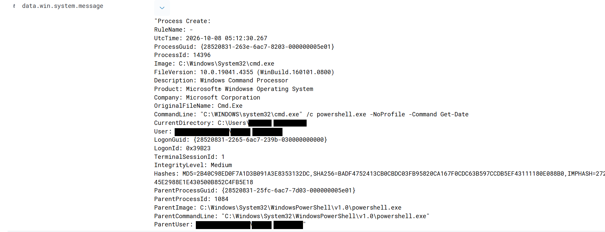
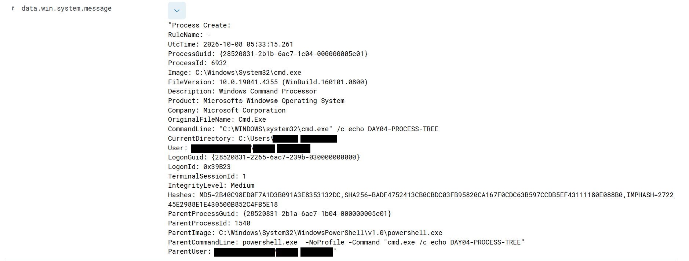
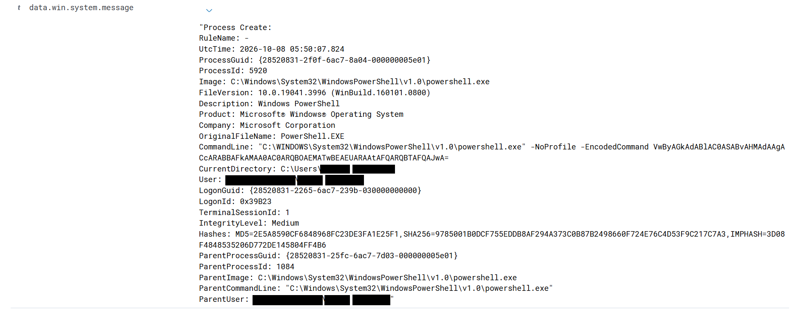
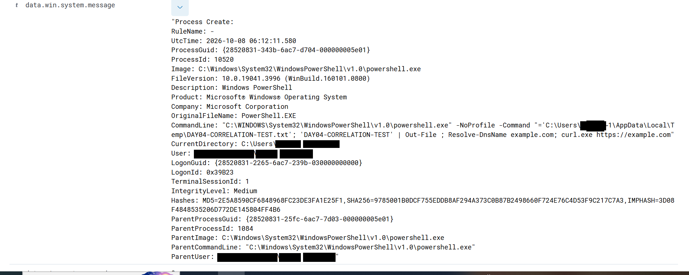
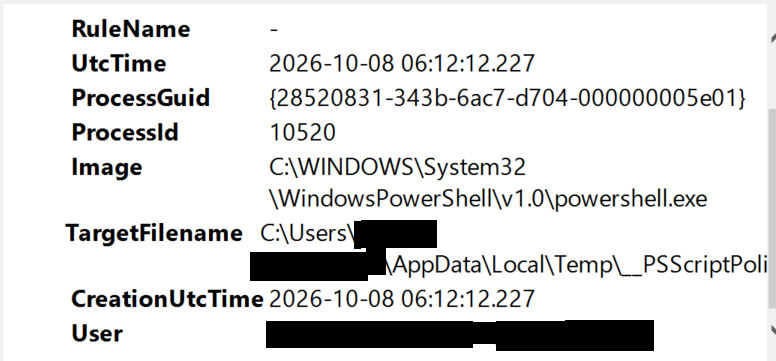
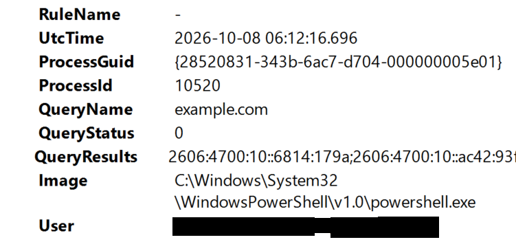

# 6. Phase 4: Advanced Process Investigation, PowerShell Hunting and Event Correlation

Phase 4 moves from reading alerts to running full SOC L1 investigations: reconstructing a process tree, hunting encoded PowerShell, and correlating process, file and DNS telemetry by ProcessGuid. The activity was run in the lab on 8 October 2026 (UTC) and followed one workflow: **Alert, Evidence, Correlation, Assessment, Verdict.** Usernames, hostnames and profile paths are replaced with placeholders for publication.

## 6.1 Process investigation: cmd.exe launching PowerShell

Command run:

    cmd.exe /c powershell.exe -NoProfile -Command "Get-Date"

Sysmon Event 1 recorded the process creation:

| **Field**          | **Value**                                                |
|------------------------------------|------------------------------------|
| Time (UTC)         | 2026-10-08 05:12:30                                      |
| Process ID / Image | 14396 / cmd.exe                                          |
| Command line       | `cmd.exe /c powershell.exe -NoProfile -Command Get-Date` |
| User / Integrity   | `lab-user` / Medium                                      |
| Parent             | PowerShell, PID 1084                                     |

The command line shows cmd.exe being used to launch PowerShell, but the PowerShell command itself is only `Get-Date`, so no malicious payload was identified.

**Verdict: Benign controlled activity.** An unusual process relationship justifies a closer look, but unusual is not the same as malicious.

*Figure 6.1: Sysmon Event 1 for cmd.exe (PID 14396), parent PowerShell (PID 1084), 2026-10-08 05:12:30 UTC, Medium integrity.*

## 6.2 Process tree reconstruction

A deeper chain was created on purpose:

    cmd.exe /c powershell.exe -NoProfile -Command "cmd.exe /c echo DAY04-PROCESS-TREE"

Three Sysmon Event 1 records were observed:

| **Time (UTC)** | **PID** | **Image**      | **Parent PID** | **Parent image** |
|----------------|---------|----------------|----------------|------------------|
| 05:33:13.863   | 16212   | cmd.exe        | 1084           | PowerShell       |
| 05:33:14.001   | 1540    | powershell.exe | 16212          | cmd.exe          |
| 05:33:15.261   | 6932    | cmd.exe        | 1540           | PowerShell       |

Reconstructed tree:

    PowerShell (PID 1084)
      -> cmd.exe (PID 16212)
           -> PowerShell (PID 1540)
                -> cmd.exe (PID 6932): echo DAY04-PROCESS-TREE

Custom Rule 100101 (PowerShell spawned by cmd.exe) fired for the PowerShell process in the middle of the chain, while the other two events produced no alert. **Telemetry can exist without an alert:** Sysmon recorded all three events, but Wazuh alerts only when a rule matches.

**Verdict: Benign controlled laboratory activity.** No encoded payload, download, suspicious file, network connection, persistence or privilege escalation was observed. The same chain in an unknown environment would still deserve investigation.

*Figure 6.2: Sysmon Event 1 for the last process in the chain: cmd.exe (PID 6932), parent PowerShell (PID 1540), command echo DAY04-PROCESS-TREE.*

## 6.3 Encoded PowerShell hunt

A Base64 payload was generated, then run with `-EncodedCommand`:

    $cmd = "Write-Host 'DAY04-ENCODED-TEST'"
    [Convert]::ToBase64String([Text.Encoding]::Unicode.GetBytes($cmd))

    powershell.exe -NoProfile -EncodedCommand <base64-string>

Sysmon Event 1 evidence: time 05:50:07 UTC, PID 5920, ProcessGuid `{28520831-2f0f-6ac7-8a04-000000005e01}`, user `lab-user`, Medium integrity, parent PowerShell (PID 1084).

The case was worked as a full investigation: alert, process, command line, decode the payload, file activity, DNS, network, persistence, context, verdict.

-   `-EncodedCommand` was treated as a suspicious characteristic, not as malware.
-   The payload decoded to `Write-Host 'DAY04-ENCODED-TEST'`, which only prints text.
-   No related Event 11, Event 22 or Event 3 was observed for this process, and no persistence or suspicious child process was found.

**Verdict: Benign controlled laboratory activity.** Encoded PowerShell is not automatically malicious: decode it, understand the behaviour, check supporting telemetry, then decide.

*Figure 6.3: Encoded PowerShell Event 1: PID 5920, ProcessGuid {28520831-2f0f-6ac7-8a04-000000005e01}, command line with -NoProfile -EncodedCommand.*

## 6.4 Correlation: process, file and DNS

The aim was to correlate several Sysmon events that belong to one process. The expected chain was Event 1 (process), Event 11 (file), Event 22 (DNS), Event 3 (network). Command run:

    powershell.exe -NoProfile -Command "$p='$env:TEMP\DAY04-CORRELATION-TEST.txt'; 'DAY04-CORRELATION-TEST' | Out-File $p; Resolve-DnsName example.com; curl.exe https://example.com"

The command line Sysmon recorded did not keep the `$p` variable as written (most likely the calling shell expanded it first). It is documented exactly as observed:

    ='C:\Users\<user>\AppData\Local\Temp\DAY04-CORRELATION-TEST.txt'; 'DAY04-CORRELATION-TEST' | Out-File ; Resolve-DnsName example.com; curl.exe https://example.com

Observed events, all from the same process:

| **Event** | **Time (UTC)** | **What was recorded**                                                                         | **Correlation evidence**                              |
|------------------|------------------|------------------|------------------|
| 1         | 06:12:11.580   | PowerShell process creation, PID 10520, parent PID 1084                                       | ProcessGuid `{28520831-343b-6ac7-d704-000000005e01}`  |
| 11        | 06:12:12.227   | File created: `__PSScriptPolicyTest_3yrc2sv.cdx.ps1` in the user's Temp folder                | Same ProcessGuid and PID, 0.647 s after process start |
| 22        | 06:12:16.696   | DNS query for `example.com`, QueryStatus 0 (answers include 172.66.147.243 and 104.20.23.154) | Same ProcessGuid, PID and image                       |
| 3         | not observed   | No network connection event                                                                   | None                                                  |

The file Event 11 recorded is PowerShell's own policy-test temporary file.

**Correlation priority:** ProcessGuid is the strongest link. PID, image, user and timestamp are supporting evidence. PID alone is not enough because process IDs can be reused.

**Event 3 was not observed.** It was not assumed to exist just because the command used `curl.exe`; the documentation records only what the telemetry proves.

**Interpretation:** process, then file, then DNS from one PowerShell instance would be worth investigating in an unknown environment. Correlation shows that activities are associated, not that they are malicious. Here the activity was intentional, the file was a policy-test file and the DNS query went to `example.com`.

**Verdict: Benign controlled activity.**

*Figure 6.4: Event 1, the PowerShell process (06:12:11.580 UTC, PID 10520).*

*Figure 6.5: Event 11, the temporary file created by the same ProcessGuid (06:12:12.227 UTC).*

*Figure 6.6: Event 22, the example.com DNS query from the same ProcessGuid (06:12:16.696 UTC).*

No screenshot exists for Event 3 because it was not observed.

## 6.5 Validation exercises: blind investigations

| **Scenario** | **Evidence**                                                                                                                             | **Verdict and reasoning**                                                                                                                                                               |
|------------------------|------------------------|------------------------|
| 1            | Rule 92027, PowerShell spawning PowerShell, `-NoProfile -Command Get-Date`                                                               | **Benign.** The command only returns the date; the alert comes from the parent-child relationship                                                                                       |
| 2            | `schtasks /Create /TN "WindowsUpdate"`, then PowerShell `-EncodedCommand`, then an external script download                              | **Suspicious, investigate immediately.** Three suspicious behaviours are chained; suspicious still does not mean confirmed malware                                                      |
| 3            | 20 failed logons (4625) across multiple accounts from 10.10.20.55 (a private address) in about 2 minutes, then a successful logon (4624) | **Suspicious, investigate.** Brute force or password spraying is the hypothesis, not a confirmed compromise. Check the logon type, which account succeeded and what happened afterwards |
| 4            | `-EncodedCommand` decoding to `Get-Date`; no Event 11, 22 or 3, no persistence, no suspicious children                                   | **Benign** based on the available evidence and the controlled context                                                                                                                   |

## 6.6 Phase 4 lessons

-   Unusual is not malicious: an odd process chain triggers investigation, not a verdict.
-   Telemetry can exist without an alert.
-   ProcessGuid is the strongest way to tie Sysmon events to one process instance.
-   Correlation shows association, not maliciousness.
-   Never invent missing telemetry: write "Event 3 was not observed" instead of completing the expected chain.
-   "Suspicious and requires investigation" is a professional verdict; "definitely malware" needs evidence.
