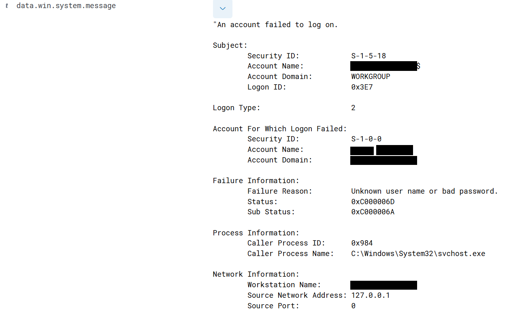
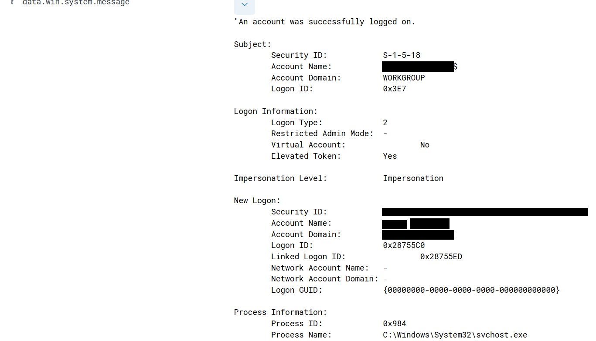
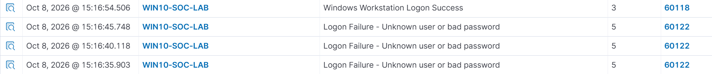

# 7. Phase 5: Windows Authentication Hunting and Authentication Correlation

Phase 5 applies the investigation method to Windows logon events: what failed and successful authentication look like in Wazuh, and why a failure-then-success sequence has to be judged as a whole rather than one alert at a time. The question that drove the phase: **does a sequence of failed logons followed by a successful logon indicate an attack, or can it be legitimate activity?**

## 7.1 Authentication events

-   **Event ID 4625:** an account failed to log on. It is not automatically an attack.
-   **Event ID 4624:** an account successfully logged on. It is not automatically legitimate, and not automatically a compromise either.

In Wazuh these appeared as Rule 60122 (Logon Failure - Unknown user or bad password, Level 5) and Rule 60118 (Windows Workstation Logon Success, Level 3). A SOC analyst needs context before giving a verdict on either one.

## 7.2 Controlled authentication test

A sequence was generated on purpose on the Windows lab machine (agent `WIN10-SOC-LAB`):

    Wrong password -> 4625 -> Wrong password -> 4625 -> Wrong password -> 4625
    -> Correct password -> 4624

The events travelled the normal pipeline and were investigated in Wazuh under Threat Hunting, Events:

    Windows Security Event -> Wazuh Agent -> Wazuh Manager -> Decoder -> Detection Rule -> Alert -> SOC Investigation

## 7.3 Event 4625 investigation: failed logon

The fields were examined rather than just the alert title:

| **Field**                     | **Value**                                     |
|------------------------------------|------------------------------------|
| Message                       | An account failed to log on                   |
| Account                       | `lab-user` (local account on the lab machine) |
| Logon type                    | 2 (interactive)                               |
| Failure reason                | Unknown user name or bad password             |
| Status / Sub status           | 0xC000006D / 0xC000006A                       |
| Source network address / port | 127.0.0.1 / 0                                 |
| Caller process                | svchost.exe (PID 0x984, hexadecimal; 2436 in decimal) |

A failed logon has many possible explanations: a mistyped password, wrong or expired credentials, an application or service using an old password, or brute force, password spraying and credential abuse. **A single 4625 event is not enough to conclude an attack.**

*Figure 7.1: Event 4625 in Wazuh: logon type 2, failure reason "Unknown user name or bad password", status 0xC000006D, sub status 0xC000006A, source 127.0.0.1.*

## 7.4 Event 4624 investigation: successful logon

After the correct password was entered, Wazuh captured the matching 4624 event:

| **Field**           | **Value**                                            |
|------------------------------------|------------------------------------|
| Message             | An account was successfully logged on                |
| Account             | `lab-user` (same account as the failures)            |
| Logon type          | 2 (interactive)                                      |
| Elevated token      | Yes                                                  |
| Impersonation level | Impersonation                                        |
| Caller process      | svchost.exe (PID 0x984 = 2436, the same as in the failures) |

This is important evidence because the success came **after** the failed attempts.

*Figure 7.2: Event 4624 in Wazuh: successful interactive logon (type 2) for the same account, elevated token, caller process svchost.exe.*

## 7.5 Authentication correlation

The most important exercise of the phase was looking at the events as one timeline. Wazuh showed them in this order (times as displayed in the dashboard):

| **Time**     | **Rule** | **Description**                              | **Level** | **Gap from previous** |
|---------------|---------------|---------------|---------------|---------------|
| 15:16:35.903 | 60122    | Logon Failure - Unknown user or bad password | 5         | start                 |
| 15:16:40.118 | 60122    | Logon Failure - Unknown user or bad password | 5         | 4.2 s                 |
| 15:16:45.748 | 60122    | Logon Failure - Unknown user or bad password | 5         | 5.6 s                 |
| 15:16:54.506 | 60118    | Windows Workstation Logon Success            | 3         | 8.8 s                 |

Three failures about 5 seconds apart, then one success within 9 seconds: same machine, same account, same logon type and same caller process. That fits a user retyping a password, which is exactly what was done.

    Multiple failures -> same authentication context -> successful authentication
    -> investigate whether the success was expected

*Figure 7.3: Wazuh events in order: three Rule 60122 failures followed by Rule 60118 success.*

## 7.6 What an analyst checks after 4625, 4625, 4625, 4624

-   **Account:** which account was targeted? A normal user, an administrator or a service account?
-   **Source:** where did the logon come from, and is that source internal and expected for this user?
-   **Logon type:** type 2 is interactive, type 3 is network, type 10 is remote interactive (RDP). The type changes how the sequence reads.
-   **Timing:** how many failures, how far apart, and is that normal for this environment?
-   **Post-authentication activity:** PowerShell or cmd, new processes, scheduled tasks or services, file creation, network connections, privilege escalation, lateral movement. This links authentication back to the process and correlation work of Phases 3 and 4.

## 7.7 Same pattern, different meaning

| **Example** | **Pattern**                                                                          | **Assessment**                                                                                                    |
|------------------------|------------------------|------------------------|
| A           | 4625 x3, then 4624                                                                   | **Benign.** The user forgot the password and then typed the right one                                             |
| B           | 4625 x20, multiple accounts, same source IP, then 4624                               | **Suspicious.** Possible password spraying (compare the Phase 3 blind scenario with 27 failures from 10.10.20.55) |
| C           | 4625 x many against a privileged account, 4624, then PowerShell and network activity | **Highly suspicious.** Possible account compromise needing immediate investigation                                |

The event itself is only one piece of evidence. The sequence and the context set the investigation priority.

## 7.8 Verdict and workflow

**Verdict: Benign, controlled authentication testing.** The failures were deliberate wrong-password attempts followed by the legitimate password. This activity alone shows no credential compromise, brute force, password spraying or account takeover.

The workflow developed in this phase:

    Authentication alert -> event ID -> account -> source -> logon type -> timestamp
    -> count failures -> look for a successful logon -> correlate events
    -> investigate post-login activity -> assess context -> verdict

Lessons:

-   4625 is a failed authentication, not automatically an attack; 4624 is a successful one, not automatically legitimate.
-   Logon type provides important context.
-   Multiple failures mean more as a pattern, and a success after failures deserves more investigation.
-   Post-authentication activity shows whether an account was actually abused.
-   Correlation beats isolated alerts, and context decides the verdict.
