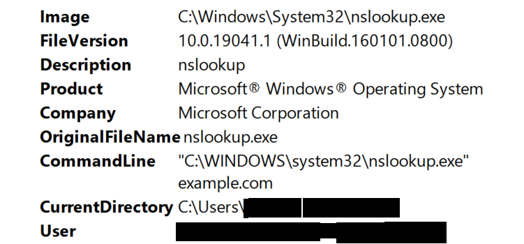
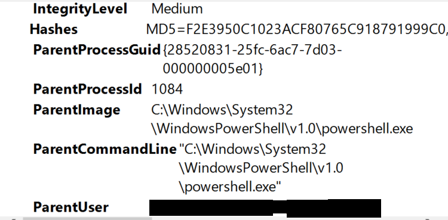
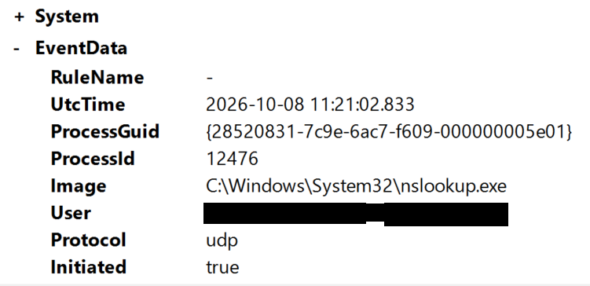
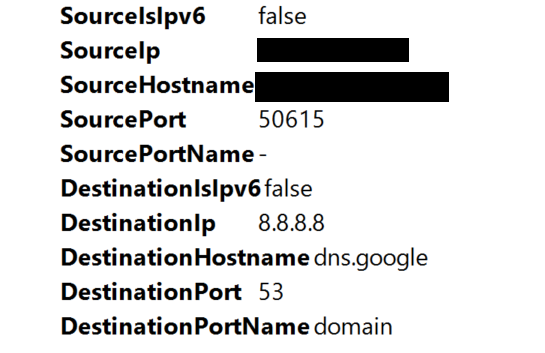
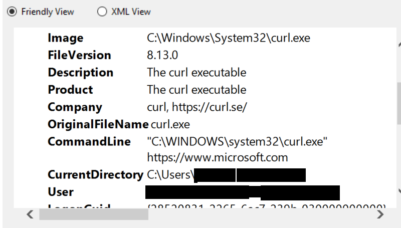
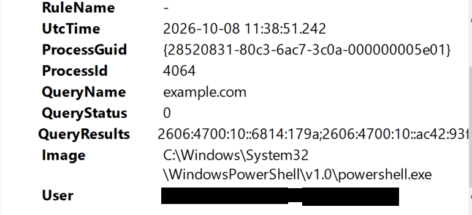
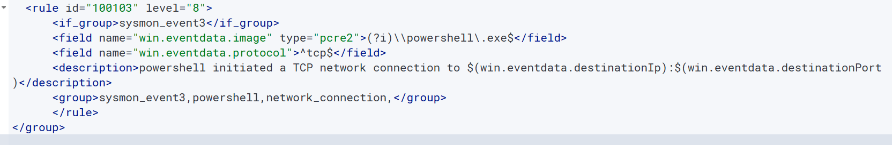

# 8. Phase 6: Network Security Monitoring and Custom Rule Troubleshooting

Phase 6 turns to network activity from a SOC analyst's view: reading Sysmon Event ID 3, correlating process, DNS, network and file events, and troubleshooting a custom network rule. This phase is documented with its failure included: a custom rule that never produced an alert is recorded as **unresolved**. Environment: Wazuh 4.14.7, Windows 10 Pro endpoint `WIN10-SOC-LAB` (Agent ID 001), manager `wazuh-server` and Sysmon.

Core principle: an alert or suspicious event is a starting point for investigation, not proof of compromise.

## 8.1 Tools and their separate jobs

- **Sysmon** records configured endpoint activity.
- **Wazuh** receives and processes endpoint events, evaluates rules and alerts when a rule matches.

## 8.2 Sysmon Event ID 3 (network connection)

Event 3 is only recorded when network connection monitoring is enabled in the Sysmon configuration.

| Field | Investigation purpose |
|---|---|
| `Image` / `ProcessId` / `ProcessGuid` | Which process made the connection, and the key for correlation |
| `User` | Account that owns the process |
| `Protocol` / `Initiated` | Transport protocol, and whether the process started the connection |
| `SourceIp` / `SourcePort` | Local end of the connection |
| `DestinationIp` / `DestinationPort` | Remote end of the connection |
| `UtcTime` | When it happened |

**Why port 443 is not a verdict.** TCP 443 is normally HTTPS/TLS, but a connection to it does not show that the traffic is legitimate or malicious. The analyst asks: which process started it, what command line launched that process, which destination IP and domain were involved, was there a DNS query first, does it fit the timeline, and is there evidence of a download, execution or persistence.

## 8.3 Correlating Sysmon events

| Event | Meaning | Use |
|---|---|---|
| 1 | Process creation | Image, command line, parent, user, PID and ProcessGuid |
| 3 | Network connection | Network activity tied to a process |
| 11 | File creation | Files a process created |
| 22 | DNS query | Domains a process asked about |

Method: find the process-creation event, note its image, command line, user, PID and ProcessGuid, find network and DNS events with the same identifiers and compatible times, check file activity, rebuild the timeline, then state what the evidence supports and what stays unknown. A matching ProcessGuid is strong evidence of the same process. A similar timestamp alone does not prove causation, and a child process has its own ProcessGuid, so parent-child links must be checked separately.

## 8.4 Endpoint evidence from Event Viewer (8 October 2026)

These screenshots come from the Sysmon event details on the endpoint (the Friendly View of Windows Event Viewer) and are timestamped 8 October 2026 (UTC). They are separate from the Wazuh archive records in Section 8.5, which are dated 9 October.

**nslookup: process creation and network connection.** `nslookup example.com` was run from PowerShell. Sysmon recorded the process creation (Event 1) and a network connection (Event 3) for `nslookup.exe`.

| Event | What was recorded |
|---|---|
| 1 | `nslookup.exe`, command line `nslookup example.com`, user `lab-user`, Medium integrity, parent `powershell.exe` (PID 1084) |
| 3 | `nslookup.exe` (PID 12476), 2026-10-08 11:21:02.833 UTC, protocol **udp**, initiated **true**, ProcessGuid `{28520831-7c9e-6ac7-f609-000000005e01}`, source [endpoint IP]:50615, destination **8.8.8.8** (`dns.google`) port **53** (domain) |

This is a clear example of Event 3 being recorded in the endpoint log: the DNS client sent a UDP query to a public resolver on port 53, which is the standard DNS port and fits the command. The Event 1 screenshots below do not show that record's ProcessGuid or timestamp, so the formal GUID link between the Event 1 and the Event 3 should be confirmed before it is stated as proven.



*Figure 8.1: Sysmon Event 1 for nslookup.exe (upper part): command line nslookup example.com, Microsoft Corporation.*



*Figure 8.2: Sysmon Event 1 for nslookup.exe (lower part): Medium integrity, parent PowerShell (PID 1084).*



*Figure 8.3: Sysmon Event 3 for nslookup.exe (upper part): UDP, initiated true, PID 12476, 2026-10-08 11:21:02.833 UTC.*



*Figure 8.4: Sysmon Event 3 for nslookup.exe (lower part): source [endpoint IP]:50615, destination 8.8.8.8 (dns.google) port 53 (domain).*

**curl.exe process creation.** Sysmon also recorded the process creation of `curl.exe` for a test request to `https://www.microsoft.com`. No Event 3 screenshot for this request is included, so nothing is claimed here about its network connection.



*Figure 8.5: Sysmon Event 1 for curl.exe 8.13.0, command line curl.exe https://www.microsoft.com.*

**PowerShell DNS query.** An Event 22 from a PowerShell process asking for `example.com`.



*Figure 8.6: Sysmon Event 22: PowerShell (PID 4064) queried example.com, QueryStatus 0, 2026-10-08 11:38:51.242 UTC.*

## 8.5 Wazuh archive evidence: Sysmon Event 3 (9 October 2026)

While troubleshooting, a real Event 3 was found in the manager's JSON archive. This is real lab evidence, not a hypothetical.

| Field | Observed value |
|---|---|
| Archive timestamp | 2026-10-09T12:26:58.636+0000 (the event's own UTC time was 12:26:57.021; these are different fields) |
| Agent / manager | `WIN10-SOC-LAB` (ID 001) / `wazuh-server` |
| Provider / Event ID / decoder | Microsoft-Windows-Sysmon / 3 / `windows_eventchannel` |
| Source | [endpoint IP]:59864 |
| Destination | 104.20.23.154:443 |
| Protocol / Initiated | tcp / true |
| Process | PowerShell, PID 17776, ProcessGuid `{28520831-cdf7-6ac8-9b06-000000005f01}` |
| User | `lab-user` |

**What it established:** an Event 3 reached the manager's archive, it was tied to agent 001 and the `windows_eventchannel` decoder, the process was PowerShell, and it carried TCP metadata for port 443.

**What it did not establish:** that the destination was malicious, that the event produced an alert, that custom rule 100103 works, or what data was sent over the connection.


*Figure 8.7: A second archived Sysmon Event 3 (10 October 2026): Opera GX sending UDP traffic to 8.8.8.8:53, decoded by windows_eventchannel. It proves the archive and decoder path for Event 3; it is not the PowerShell record described above. Names are blacked out for publication.*

This screenshot shows a different Event 3 from the table above (Opera GX, UDP, 10 October), and it is discussed in Phase 7 (Section 9.2).

## 8.6 Wazuh archive evidence: matching DNS (Event 22)

An archived Event 22 carried the same ProcessGuid `{28520831-cdf7-6ac8-9b06-000000005f01}` (PID 17776, `powershell.exe`) with query name `example.com`, and one recorded result included `104.20.23.154`. That supports linking the DNS lookup to the PowerShell connection to `104.20.23.154:443` by ProcessGuid. A further Event 22 near 2026-10-09 12:26:57.374 had DNS status 9701, and another nearby record had status 0 with IPv6 results plus `104.20.23.154`. These are separate records and are not merged.

This is endpoint-event correlation. It does not by itself show malicious activity.

## 8.7 Troubleshooting custom rule 100103 (unresolved)

**The problem.** Event 3 records were in the manager's JSON archive, but the custom rule meant to detect PowerShell network connections never produced an alert: no alert with ID `100103` was found in the alerts file.

**Built-in rule.** Rule 61605 in `/var/ossec/ruleset/rules/0595-win-sysmon_rules.xml` matches Sysmon Event 3. Its level is 0, so it works as an informational parent and does not alert by itself:

```xml
<rule id="61605" level="0">
  <if_sid>61600</if_sid>
  <field name="win.system.eventID">^3$</field>
  <description>Sysmon - Event 3: Network connection to $(win.eventdata.destinationIp):$(win.eventdata.destinationPort) by $(win.eventdata.image)</description>
  <options>no_full_log</options>
  <group>sysmon_event3,</group>
</rule>
```

**Custom rule.** Rule 100103 lives in `/var/ossec/etc/rules/local_rules.xml`, inside the outer group of that file (shown as `local,syslog,sshd,` in the Phase 8 capture, Section 10.8), and uses a group condition:

```xml
<rule id="100103" level="8">
  <if_group>sysmon_event3</if_group>
  <field name="win.eventdata.image" type="pcre2">(?i)\\powershell\.exe$</field>
  <field name="win.eventdata.protocol">^tcp$</field>
  <description>powershell initiated a TCP network connection to $(win.eventdata.destinationIp):$(win.eventdata.destinationPort)</description>
  <group>sysmon_event3,powershell,network_connection,</group>
</rule>
```



*Figure 8.8: Rule 100103 in local_rules.xml: if_group sysmon_event3, image ends in powershell.exe, protocol tcp, level 8.*

**Steps and what each one showed**

1. **Validation.** `sudo /var/ossec/bin/wazuh-analysisd -t` reported no configuration errors. That shows the files are valid, not that the rule matches a real Event 3.
2. **Searching for the alert.** `grep '"id":"100103"' /var/ossec/logs/alerts/alerts.json` found nothing. This shows the file had no such alert at that time, not why.
3. **Turning on JSON archiving.** To see incoming events, `<logall_json>yes</logall_json>` was set temporarily (with `<logall>no</logall>` unchanged) and `/var/ossec/logs/archives/archives.json` was checked. A real Event 3 appeared there, with `decoder.name` `windows_eventchannel` and `location` `EventChannel`. So the event reached the manager and was represented as an EventChannel record, yet the alert was still missing.
4. **wazuh-logtest.** A manual test returned `Phase 2: No decoder matched`. The input had not been rebuilt in a form the decoder accepts, so this does **not** prove the live event was undecoded. A later attempt to pull an event out of the archive returned `NO_MATCHING_EVENT` because the filter did not fit the escaped, nested JSON, and one Python attempt hit a variable-name `NameError` that was then fixed.

The pipeline stages that were separated: Sysmon creates the event, Wazuh receives it, the decoder parses it, rules are evaluated, and a matching alert-producing rule raises the alert. The failure sits somewhere after "decoder identified" and before "alert raised".

**Possible lead.** Wazuh GitHub issue #38097 describes similar reports of Sysmon Events 3 and 22 being archived without the expected alerts in some versions. The lab runs 4.14.7. It is a research lead only; similar symptoms do not prove the same cause.

**Final status: unresolved, further troubleshooting deferred.**

| Established | Not established |
|---|---|
| A real Event 3 exists in the archive | Why rule 100103 produced no alert |
| The archived record shows the `windows_eventchannel` decoder | Any working fix |
| Built-in rule 61605 exists and 100103 is in the reviewed config | That issue #38097 explains this behaviour |
| Configuration validation reported no errors | |
| No alert with ID 100103 was found | |
| Manual logtest attempts did not reproduce the archived event | |

No successful fix is claimed.

**Cleanup to check.** JSON archiving was enabled only to diagnose the problem, and its final state was **not verified**. Check `/var/ossec/etc/ossec.conf`. If `<logall_json>` is still `yes` and is no longer needed, set it back to `no`, keep `<logall>no</logall>`, validate, restart the manager if required and confirm the service is running. Leaving it on indefinitely can use a lot of disk space.

## 8.8 Hypothetical investigation: Word launching PowerShell

> **Training scenario only.** This was a fictional exercise. It was not an attack on the lab endpoint, and none of its evidence comes from the lab.

| Stage | Evidence in the scenario | Reading |
|---|---|---|
| 1 | `WINWORD.EXE` starts `powershell.exe` and an outbound TCP 443 connection follows | **Suspicious, needs investigation.** Word launching PowerShell can mean a malicious document, but also unusual legitimate workflows |
| 2 | PowerShell uses `-NoProfile`, `-WindowStyle Hidden` and `-EncodedCommand`; payload unknown | Concern rises in combination, but encoding alone and hidden execution alone prove nothing |
| 3 | PowerShell tries to download a script, a `.ps1` file appears in the temp folder (Event 11), a network connection occurs; no proof of execution or persistence | Still not confirmed |

Next steps: decode the command, examine the script safely, record its hash and signature, correlate process, file, DNS and network records, look for execution, check scheduled tasks and registry if persistence is suspected, and establish whether the activity was authorized. Chain to assess as a whole: `WINWORD.EXE` then `powershell.exe`, outbound connection, script file created, then execution and impact. **Final scenario verdict: suspicious, pending investigation.** The evidence does not support claiming malware or a real compromise.

## 8.9 Hypothetical network exercises

> These are also training scenarios, not lab events.

| Exercise | Scenario | Verdict and next steps |
|---|---|---|
| A | Encoded PowerShell queries an unfamiliar domain, the same ProcessGuid connects to an external IP on 443, and a file is created in temp | **Suspicious.** The chain warrants investigation but does not prove the file is malicious. Decode the command, examine the destination, inspect the file safely, establish whether it ran |
| B | A decoded command downloads a file from an unfamiliar server into temp | **Suspicious, immediate investigation reasonable.** Preserve evidence, check hash and signature, determine whether it ran. A download alone is not proof of malware |
| C | One workstation makes 30 connection attempts to 25 internal IPs in 20 seconds, started by PowerShell, no approved scan documented | **Suspicious.** Could be discovery or port scanning, but authorized scanning looks similar. Check the command line, ports and outcomes, parent-child chain, and any approved scanning |
| D | Several connections to internal systems on TCP 445, then a new process with unknown purpose | **Suspicious, pending.** Examine the new process (Event 1, parent, command line, user, privileges, file and network activity) and whether it relates to the earlier scanning. Port 445 is SMB, but the port alone proves nothing |
| E | PowerShell launches `cmd.exe` running `whoami` and `ipconfig` as the logged-in user | **Needs further investigation**, with the earlier scanning kept in view. Both commands are legitimate; judge the combined evidence, not one command |

## 8.10 Verdict framework

| Verdict | Meaning |
|---|---|
| Benign | Evidence supports legitimate activity in context |
| Suspicious | Concerning characteristics that need further investigation |
| Needs further investigation | Not enough evidence for a reliable classification |
| Confirmed malicious | Evidence sufficiently establishes malicious activity |

A suspicious event is not automatically malware, and the absence of an alert does not mean nothing happened.

## 8.11 Phase 6 lessons

- Event collection is not alert generation: an event can sit in the archive without the expected custom alert.
- Decoder success is not rule-match success.
- Configuration validation does not prove detection logic works.
- ProcessGuids support correlation; timestamps and parent-child links add context.
- Network ports are not verdicts: 443 and 445 need destination, process, intent and surrounding activity.
- A correlated suspicious sequence deserves investigation, but still needs validation.
- Hypothetical exercises must stay labelled as hypothetical.
- An unresolved issue must be documented honestly: a troubleshooting attempt is not a fix.

## 8.12 Phase 6 status

**Covered:** Event 3 fields, Events 1/3/11/22 correlation concepts, Wazuh archive, decoder, rule and alert stages, the troubleshooting history of rule 100103, and the hypothetical investigations.

**Deferred or unresolved:**

1. The root cause of the missing alert for rule 100103.
2. Whether Wazuh issue #38097 applies to this lab.
3. The final state of temporary JSON archiving.
