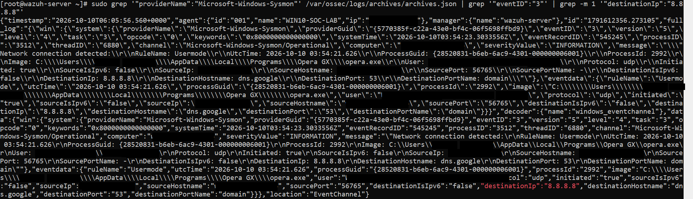
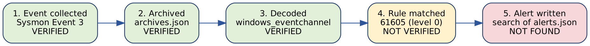

# 9. Phase 7: MITRE ATT&CK Mapping and Detection Validation

Phase 7 asks two questions that every detection engineer has to answer honestly. First: **can an observed event really be mapped to a MITRE ATT&CK technique?** Second: **did the Wazuh detection pipeline actually produce the alert I expected?** The evidence for this phase was collected on 10 October 2026 and reviewed on 11 October 2026.

## 9.1 Phase 7 at a glance

| **Question** | **Evidence** | **Answer** |
|---|---|---|
| Does Wazuh collect Sysmon network telemetry? | Archived Sysmon Event 3 record (Figure 9.1) | **Yes**, collected, archived and decoded by `windows_eventchannel` |
| Was an alert generated for rule 61605 or 100103? | `grep` of `alerts.json` for both IDs | **No matching record found**; see Section 9.3 for how to read this |
| Is the event malicious? | `opera.exe` to `8.8.8.8:53` over UDP | **No malicious activity established**; consistent with ordinary DNS |
| Can it be mapped to ATT&CK? | Single event, no adversarial context | **No technique confirmed**; T1071.004 is not assigned |

**Environment:** Wazuh 4.14.7, manager `wazuh-server`, agent `WIN10-SOC-LAB` (ID 001), Sysmon telemetry from `Microsoft-Windows-Sysmon/Operational`.

## 9.2 Practical 1: verify Sysmon network telemetry

A real Sysmon Event ID 3 record was located in the manager's archive with this command (first Event 3 whose destination is 8.8.8.8):

    sudo grep '"providerName":"Microsoft-Windows-Sysmon"' /var/ossec/logs/archives/archives.json \
      | grep '"eventID":"3"' | grep -m 1 '"destinationIp":"8.8.8.8"'

| **Field** | **Observed value** |
|---|---|
| Sysmon Event ID | 3 (network connection) |
| Process | `opera.exe` (Opera GX), PID 2992 |
| ProcessGuid | `{28520831-b6eb-6ac9-4301-000000006001}` |
| Protocol | UDP, initiated true |
| Source | [endpoint IP], port 56765 |
| Destination | 8.8.8.8 (`dns.google`), port 53 (domain) |
| Event time (UTC) | 2026-10-10 03:54:21.626 |
| Archive timestamp | 2026-10-10T06:05:56.560+0000 |
| Decoder | `windows_eventchannel` |
| Agent / manager | `WIN10-SOC-LAB` (ID 001) / `wazuh-server` |

*Figure 9.1: Archived Sysmon Event 3 in /var/ossec/logs/archives/archives.json: Opera GX (opera.exe, PID 2992) sent UDP traffic from [endpoint IP]:56765 to 8.8.8.8:53 (dns.google), decoded by windows_eventchannel. Machine and user names are blacked out for publication.*

> **Key takeaway:** Sysmon network telemetry reaches the Wazuh manager and is decoded correctly. Collection and decoding work for Event 3.

**A detail worth noting.** The archive timestamp (06:05:56) is about **2 hours 11 minutes after** the event's own UTC time (03:54:21). In Phase 6 the same two fields differed by under two seconds. Phase 8 found a boot-time Event 1 archived eight seconds earlier (06:05:48) with the same delay (Figure 10.2), which suggests one backlog of events delivered together after the agent had been unable to reach the manager. That is a hypothesis, not a confirmed cause.

## 9.3 Practical 2: check alert generation

Two searches were run against the alerts file:

    sudo grep '"id":"61605"' /var/ossec/logs/alerts/alerts.json | tail -n 5
    sudo grep '"id":"100103"' /var/ossec/logs/alerts/alerts.json | tail -n 5

Both returned **no matching records**. The original conclusion was that the expected detection was not verified and that the cause was unresolved.

*Figure 9.2: Where the Phase 7 evidence stops in the Wazuh pipeline. The event was collected, archived and decoded; no alert record was found.*

**Reading the result correctly (added during documentation review).** These two searches do not prove that the detection pipeline failed for this event, for two reasons that follow from the rules themselves (Section 8.7 and Section 14):

1.  **Rule 61605 has level 0.** It is an informational parent rule, and by design it does not write alerts. The alerts file normally holds only alerts at or above the configured alert level (`log_alert_level` in `ossec.conf`), so an empty search for 61605 is the expected result.
2.  **Rule 100103 could not match this event.** It requires `powershell.exe` and protocol `tcp`. This record is `opera.exe` over UDP, so the rule is correct to stay silent.

> **Key takeaway:** the empty searches show that an archived event is not an alert. They do not test rule 100103. A valid test needs a **PowerShell TCP** Event 3, such as the 9 October record in Section 8.5, and a search for `100103` after it. That open problem from Phase 6 remains unresolved.

## 9.4 Practical 3: interpret the event

Opera GX contacted Google's public DNS resolver on UDP port 53. A browser resolving names through a public resolver is ordinary behaviour, and a network connection alone does not establish malicious activity. Facts that would change the picture, none of which were observed: an unusual process making the connection, a rare or unexpected DNS server, very high query volume or very long query names, or a connection from a process that should not use the network.

## 9.5 MITRE ATT&CK mapping method

MITRE ATT&CK mapping has to be supported by observed behaviour. An event ID, a tool name or a rule level is not enough on its own. The method used:

    Observed behaviour -> candidate technique -> evidence that would confirm it
    -> context (is it authorised or normal?) -> mapping decision

| **Observed behaviour** | **Candidate technique** | **Evidence needed to confirm** | **Decision** |
|---|---|---|---|
| `schtasks /Create ... /SC ONLOGON` (Phase 3) | T1053.005 Scheduled Task | Command line, what the task runs, who created it | **Mapped** in rule 100102 as a detection tag; the lab test itself was benign |
| `-EncodedCommand` PowerShell (Phase 4) | T1059.001, T1027 | Decoded content, parent process, follow-on activity | **Candidate only**; the content decoded to `Get-Date` |
| Three failed logons, then success (Phase 5) | T1110 Brute Force | Many attempts, several accounts, an external source | **Not mapped**; one local account, three attempts, controlled test |
| `opera.exe` UDP to 8.8.8.8:53 (Phase 7) | T1071.004 DNS | Unusual resolver, volume or query pattern, adversarial context | **Not mapped**; consistent with ordinary DNS |

> **Key takeaway:** a MITRE tag describes a technique. It is a hypothesis to test, not proof that an attacker used it.

## 9.6 Verdict and status

> **Verdict:** No malicious activity established from the available evidence. This applies only to the evidence reviewed and does not prove the endpoint is completely safe.

| **Item** | **Status** |
|---|---|
| Sysmon Event 3 collected, archived and decoded | Verified |
| Event consistent with ordinary DNS | Assessed, benign |
| ATT&CK technique for this event | None confirmed, none assigned |
| Alert for rule 61605 | Not expected (level 0), no record found |
| Alert for rule 100103 on a PowerShell TCP Event 3 | **Unresolved**, still to test |
| Cause of the 2 h 11 min archive delay | **Hypothesis only** (one delayed batch, see Section 10.5); not confirmed |

**Lessons**

-   Event collection and alert generation are separate stages.
-   An archived event does not prove that a rule matched, and a silent rule is not always a broken rule: check the rule's own conditions first.
-   MITRE mappings must be supported by evidence.
-   Normal network behaviour should not automatically be classified as malicious.
-   An unresolved detection gap is a valid portfolio finding when it is documented honestly.

**Next:** Phase 8, Advanced Detection Engineering: custom rule matching, validation and alert generation.
