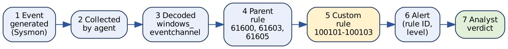
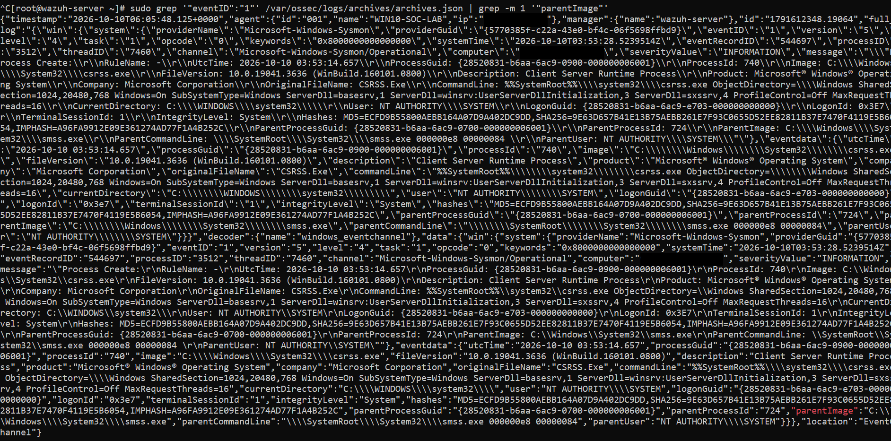
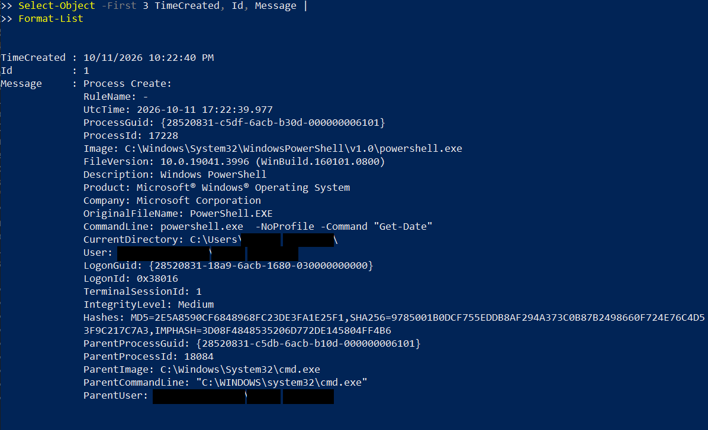
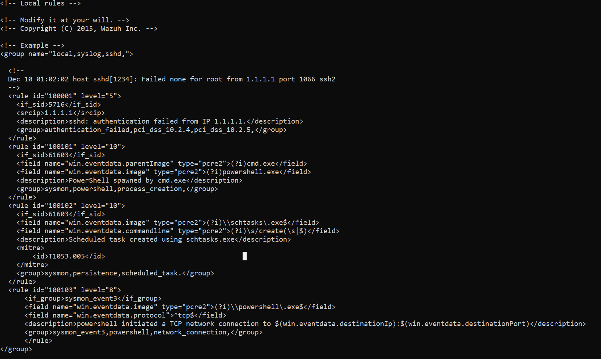
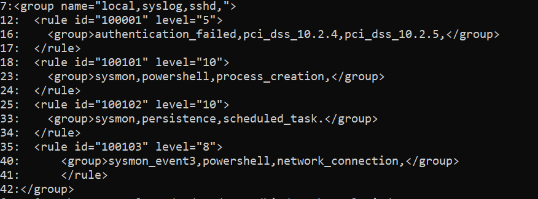

# 10. Phase 8: Advanced Detection Engineering

Phase 7 showed that a silent rule is not always a broken rule. Phase 8 turns that lesson into a method. The question that drives it is the one a detection engineer must be able to answer for every rule: **why does this rule fire, when will it stay silent, and what harmless activity could trigger it?** This phase reviews the two custom detections confirmed as working (100101 and 100102), the built-in rules they depend on, the live rule file, and the one detection that is still unresolved (100103). Evidence was collected on 10 and 11 October 2026.

## 10.1 Phase 8 at a glance

| **Rule** | **Detects** | **Status** | **Evidence in this document** |
|---|---|---|---|
| 100101 (level 10) | `cmd.exe` starting `powershell.exe` | **Confirmed working by the author** | Rule file (Figures 5.1, 10.4), trigger event (Figure 10.3), Phase 4 process chain. |
| 100102 (level 10, T1053.005) | `schtasks.exe` with `/create` | **Confirmed working by the author** | Alert details (Figure 5.7), alert row (Figure 11.2), rule file (Figure 10.4) |
| 100103 (level 8) | PowerShell TCP network connection (Event 3) | **Unresolved** | Rule file (Figures 8.8, 10.4); no matching alert observed |

> **Key takeaway:** this phase found that the live rule file differs from what the earlier phases documented (Section 10.8). The differences are recorded openly, and the live file is now the reference.

## 10.2 Objectives

1.  Follow an event from collection to alert and name every stage.
2.  Review the built-in parent rules that the custom rules depend on.
3.  Explain the logic, benign triggers and blind spots of rules 100101 and 100102.
4.  Check the live rule file against the documentation.
5.  Use precise verdict terminology and an evidence-based workflow.
6.  Record rule 100103 and the archive setting honestly as unresolved.

## 10.3 The event-to-alert pipeline

*Figure 10.1: The seven stages between an endpoint event and an analyst verdict. A detection can fail at any stage, so a missing alert has to be located before it can be fixed.*

| **Stage** | **What happens** |
|---|---|
| 1. Event generation | Windows and Sysmon record the activity, for example a process creation |
| 2. Collection | The Wazuh agent reads the configured event channel and forwards it to the manager |
| 3. Decoding | The manager structures the event and exposes fields such as `win.eventdata.image` |
| 4. Parent-rule match | A built-in rule identifies the event type (Event 1, Event 3) |
| 5. Custom-rule match | A local rule adds conditions on the image, parent or command line |
| 6. Alert generation | When all conditions match, Wazuh writes an alert with a rule ID, level, description and event context |
| 7. Analyst investigation | A person decides whether the behaviour is authorised, benign, suspicious or needs more work |

A rule match is a detection signal. It is not proof that an attack occurred.

## 10.4 Rule hierarchy

The built-in Sysmon rules live in `/var/ossec/ruleset/rules/0595-win-sysmon_rules.xml`.

    60004   Windows event channel (parent)
     └─ 61600   Sysmon base rule (severity INFORMATION)
          ├─ 61603   Event 1, process creation
          │    ├─ 100101   PowerShell from cmd.exe  [if_sid]
          │    └─ 100102   schtasks /create         [if_sid]
          └─ 61605   Event 3, network connection (level 0)
               └─ 100103   PowerShell TCP connection  [if_group]

Both working rules inherit from **61603** with `<if_sid>`, so their input is always a process-creation event that has already matched the parent rule. Rule 100103 is built differently: it uses `<if_group>sysmon_event3</if_group>` instead of `<if_sid>61605</if_sid>`. This structural difference is an observation, not a proven cause of the missing alert (see Section 10.12).

## 10.5 What the decoded fields really look like

Rules can only test fields that the decoder actually produces. Figure 10.2 shows an archived Event 1 as stored by the manager. The first Event 1 containing `parentImage` happened to be a boot-time `csrss.exe` record, so it is used here only to show field names, not as a test event.

*Figure 10.2: Archived Sysmon Event 1 in archives.json, decoded by windows_eventchannel. Under data.win.eventdata the fields are written in camelCase (image, commandLine, parentImage, user, processGuid). The computer name is blacked out for publication.*

-   The decoder is `windows_eventchannel` and the Sysmon event ID is 1.
-   Field names are camelCase: `parentImage`, `commandLine`, `processGuid`. This matters in Section 10.8.
-   **Timing.** This record carries the archive timestamp `2026-10-10T06:05:48` for an event created at `03:53:14` UTC. The Opera GX Event 3 from Phase 7 was archived at `06:05:56` for an event created at `03:54:21`. Both records arrived within eight seconds of each other, about 2 hours 12 minutes after the Windows boot (the `csrss.exe` start). This suggests one backlog of events delivered together, for example after a period when the agent could not reach the manager. **That is a supported hypothesis, not a confirmed cause.**

## 10.6 Rule 100101: PowerShell spawned by cmd.exe

**Logic.** The event must match parent rule 61603 (process creation), the parent image must match `cmd.exe` and the child image must match `powershell.exe`, both case-insensitively. A match raises a **level 10** alert.

**Trigger used in the lab.** A fresh test was run on 11 October 2026 from a Command Prompt:

    powershell.exe -NoProfile -Command "Get-Date"

*Figure 10.3: Sysmon Event 1 in Event Viewer for the test: powershell.exe with command line -NoProfile -Command "Get-Date", parent cmd.exe (PID 18084), Medium integrity. User and folder names are blacked out for publication.*

| **Field** | **Value** |
|---|---|
| Time (UTC) | 2026-10-11 17:22:39.977 (10:22:40 PM local, UTC+5) |
| Image | `C:\Windows\System32\WindowsPowerShell\v1.0\powershell.exe`, PID 17228 |
| ProcessGuid | `{28520831-c5df-6acb-b30d-000000006101}` |
| Parent | `C:\Windows\System32\cmd.exe`, PID 18084, ParentProcessGuid `{28520831-c5db-6acb-b10d-000000006101}` |
| Integrity level | Medium |

This is exactly the relationship the rule describes. The command only prints the date, so the activity is a **benign true positive**: the rule is right about the process relationship, and the relationship is legitimate here.

**Legitimate triggers (benign activity):** an administrator opening PowerShell from Command Prompt, a batch file calling PowerShell for maintenance, installers and IT-management scripts.

**Analyst checklist:** read the full command line and any encoded arguments; confirm the user and whether the activity was expected; verify parent and child paths; review the process tree and nearby process-creation events; correlate file, registry, authentication and network activity by ProcessGuid and timestamp.

**Limitations.** The rule detects one parent-child relationship and does not prove intent. It does not match PowerShell started by a different parent or another method, and it does not inspect what runs inside PowerShell.

## 10.7 Rule 100102: scheduled-task creation (T1053.005)

**Logic.** Parent rule 61603, an image ending in `schtasks.exe`, and a command line containing `/create` as an option. A match raises a **level 10** alert mapped to MITRE ATT&CK **T1053.005, Scheduled Task/Job: Scheduled Task**. The mapping names the technique; it does not mean every detected task is malicious.

**Evidence.** The rule firing on a fresh test is shown in Phase 3 (Figure 5.7) and as a Wazuh Discover row in Phase 9 (Figure 11.2); the troubleshooting history is in Section 5.4.

**Legitimate triggers:** installers registering update tasks, administrators scheduling maintenance, security products registering scans, applications creating background tasks.

**Analyst checklist:** identify the task name and creating account; inspect what the task will run and where that file is; review the trigger, schedule and run-as account; look for related file creation, downloads or unusual PowerShell activity; confirm the task was authorised.

**Limitations.** The rule matches `schtasks.exe /create` only. Tasks can be created by other mechanisms that it does not see, and a task name alone does not show whether a task is legitimate.

## 10.8 Live rule file check and reconciliation

Figures 10.4 and 10.5 show `/var/ossec/etc/rules/local_rules.xml` as it was on 11 October 2026.

*Figure 10.4: The live local_rules.xml: sample rule 100001, then custom rules 100101, 100102 and 100103, all inside one outer group.*

*Figure 10.5: Structure of the same file by line number: outer group at line 7 (local,syslog,sshd,), rules at lines 12 to 17 (100001), 18 to 24 (100101), 25 to 34 (100102), 35 to 41 (100103), group closed at line 42.*

Comparing the live file with what Phases 3 and 6 and the earlier rules reference said:

| **Item** | **Earlier documentation** | **Live file (11 Oct)** | **Impact and action** |
|---|---|---|---|
| 100101 parent and image patterns | `(?i)\\cmd\.exe$` and `(?i)\\powershell\.exe$` | `(?i)cmd.exe` and `(?i)powershell.exe` | The live patterns are **looser**: no end anchor and the dot is unescaped, so any path or name containing `cmd` or `powershell` followed by any character and `exe` matches. The rule works for the test but could over-match. A tighter version is proposed in Section 14 |
| 100102 command-line field | Phase 3 states the field was corrected to `win.eventdata.commandLine` | `win.eventdata.commandline` (all lowercase) | **Unresolved discrepancy.** The decoder writes `commandLine` (Figure 10.2), yet the author confirms the alert fires. Either the lowercase spelling also matches, which would make the Phase 3 explanation incomplete, or the file changed after the confirmed alert. A controlled retest settles it (Section 10.12). Note that the 100102 alert in Figure 11.2 was raised on 7 October; if the file was not edited between 7 and 11 October, the lowercase spelling matched, but the screenshots cannot show that |
| 100102 group tag | not documented | `sysmon,persistence,scheduled_task.` with a **period** | Groups are comma separated. The period creates a tag named `scheduled_task.`. Cosmetic, but it should read `scheduled_task,` |
| Outer group name | Section 8.7 stated `windows,sysmon,custom_network_detection,` | `local,syslog,sshd,` | Corrected in Section 8.7. This is Wazuh's sample group name. It adds those group labels to the rules and is not believed to affect matching, but it is misleading and should be renamed |
| Sample rule 100001 | not documented | still present (`sshd` failure from 1.1.1.1) | Harmless Wazuh example; remove it or leave it, but do not confuse it with lab detections |
| 100103 layout | identical rule | indentation differs from the other rules | Cosmetic only |

The screenshot proves the state of the file on 11 October. It does not prove which version was active when each earlier alert was generated.

> **Key takeaway:** documentation must follow the live configuration. Where the two disagree, the disagreement is recorded as a finding instead of being quietly rewritten.

## 10.9 Verdict terminology

| **Term** | **Meaning** | **Lab example** |
|---|---|---|
| Benign true positive | The rule correctly detects the configured behaviour and the behaviour is legitimate | 100101 on `powershell -NoProfile -Command "Get-Date"` from `cmd.exe` |
| False positive | The alert indicates a condition that did not occur, because of a detection or parsing mismatch | A looser pattern matching an unrelated file name (possible with the unanchored 100101 patterns, not observed) |
| Suspicious | Evidence raises concern but does not establish malice | Encoded PowerShell with an unexplained scheduled task |
| Needs investigation | Not enough context for a reliable decision | A new task created by an unknown account |
| Confirmed malicious | Evidence supports malicious activity; never based on a rule match alone | None in this lab |

A level 10 is the severity the rule author configured. It is not a confidence score and not proof of an attack.

## 10.10 Evidence-based investigation workflow

1.  Read the rule description, ID, level, timestamp and agent.
2.  Read the full command line and executable path.
3.  Identify the user, parent process and child process.
4.  Decide whether the activity is expected for that user and host.
5.  Correlate nearby events by ProcessGuid and PID, using timestamps as supporting evidence.
6.  Look for supporting evidence: unexpected files, persistence changes, network connections.
7.  Assign a cautious verdict and write down the evidence for it.
8.  Escalate or keep investigating when context is missing.

A single event, IP address, process name or MITRE mapping is never sufficient proof of malicious activity.

## 10.11 Detection quality review

| **Rule** | **What it covers** | **Known blind spots** | **Likely noise** | **Proposed improvement** |
|---|---|---|---|---|
| 100101 | `cmd.exe` to `powershell.exe` | PowerShell started by other parents, other PowerShell hosts and renamed copies of the binary | Admin scripts, installers, logon scripts | Anchor the patterns; add a higher-severity variant when the command line contains `-EncodedCommand` or a download |
| 100102 | `schtasks.exe /create` | Tasks created through other interfaces or APIs, and `/change` on existing tasks | Updaters, IT tools | Add the task action (`/TR`) to the alert; raise severity when the action runs PowerShell or an unusual path |
| 100103 | PowerShell and TCP connections | Not yet working | Would be high for any PowerShell web request | Fix first; then restrict by destination or port |

These are design observations from reading the rules. None of the proposed improvements has been deployed or tested yet.

## 10.12 Unresolved items

**Rule 100103.** What is established: Event 3 records are collected, archived and decoded (Section 9.2); the PowerShell TCP Event 3 of 9 October exists in the archive (Section 8.5); the rule passes `wazuh-analysisd -t`. What is **not** established: that the rule matches any event or produces an alert. The Opera GX UDP event is not a test of this rule. Untested hypotheses, in the order they would be tried:

1.  Replace `<if_group>sysmon_event3</if_group>` with `<if_sid>61605</if_sid>`, matching how the working rules are built.
2.  Check the `protocol` field name and value in a full archived PowerShell Event 3 against the rule condition.
3.  Replay the exact archived JSON through `wazuh-logtest` (Phase 6 logtest used input the decoder did not recognise).
4.  Compare with the upstream Wazuh issue #38097, which is an unconfirmed lead for this lab.

**Retest of the 100102 field spelling.** Change one spelling at a time, run `sudo /var/ossec/bin/wazuh-analysisd -t`, restart the manager, create a task with a new name, and record whether the alert fires. Do this on a copy of the file and note the result for both spellings.

**Archive setting.** `<logall_json>` was temporarily set to `yes` for troubleshooting. Its current value has not been verified. Check it with `grep -n "logall" /var/ossec/etc/ossec.conf`, restore the intended value, validate the configuration and restart the manager. Archives did contain data on 10 October (Figure 10.2), which says nothing about today's setting.

## 10.13 Phase 8 status

| **Item** | **Status** |
|---|---|
| Pipeline and rule hierarchy documented | Complete |
| Rules 100101 and 100102 explained, with benign triggers and blind spots | Complete |
| Rule 100101 trigger event captured | Complete (Figure 10.3) |
| Live rule file captured and compared with the documentation | Complete, discrepancies recorded |
| 100102 field spelling retest | Planned |
| Rule 100103 | **Unresolved** |
| `logall_json` current value | **Not verified** |

**Lessons**

-   Document the live configuration, not the configuration you remember.
-   A rule that works is not necessarily a well-written rule: looser patterns, odd tags and unexplained spelling differences are technical debt.
-   Use precise verdict terms and never treat severity as confidence.
-   An unresolved detection is a valid portfolio finding when it is recorded honestly.

**Portfolio principle:** document real observations, label unresolved work clearly, and base verdicts on correlated evidence rather than alert severity.
