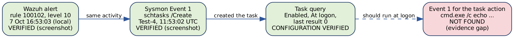
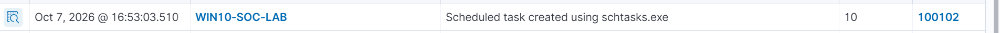
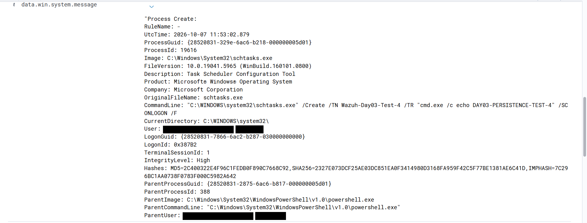
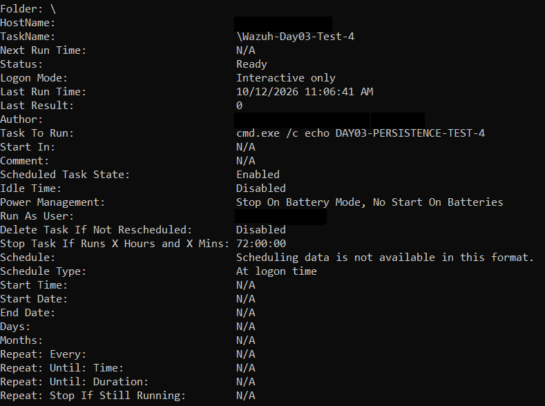

# 11. Phase 9: Detection Validation and SOC Investigation

Phases 7 and 8 asked whether a detection works. Phase 9 asks the analyst's question that comes after an alert: **what does the evidence actually prove?** The case revisits the scheduled task from Phase 3 (`Wazuh-Day03-Test-4`) five days later. It starts from a real Wazuh alert, follows it through the Sysmon record and the live task configuration, and ends with a verdict that separates what was **observed** from what was only **inferred**. The investigation was carried out on 12 October 2026.

## 11.1 Case at a glance

| **Item** | **Detail** |
|---|---|
| Case | Review of a scheduled task created by `schtasks.exe /Create` |
| Host / agent | `WIN10-SOC-LAB` (ID 001), Windows 10 Pro |
| Detection | Custom rule **100102**, level 10, MITRE ATT&CK T1053.005 |
| Task under review | `\Wazuh-Day03-Test-4`, action `cmd.exe /c echo DAY03-PERSISTENCE-TEST-4`, trigger at logon |
| Verdict | **Likely benign lab activity; execution details not fully corroborated** |
| Evidence limitation | No Sysmon record of the task action itself was found in the evidence reviewed |

> **Key takeaway:** an alert shows that something matched a rule. It does not show what happened afterwards. No alert for an action does not mean the action did not happen, and it does not mean Wazuh failed.

## 11.2 Events, alerts and execution evidence

A Windows event can be collected by Wazuh and be available for investigation without producing an alert. An alert exists only when an event passes through analysis and matches a rule that raises one. Three different things are easy to confuse in this case:

| **Artefact** | **What it is** | **What it proves** |
|---|---|---|
| Sysmon Event 1 for `schtasks.exe /Create` | A process-creation event | The command that created the task was run |
| Wazuh alert for rule 100102 | A detection raised from that event | The event matched the rule's conditions |
| Event for the task's action (`cmd.exe /c echo ...`) | A separate process-creation event, only if the task ran | That the action actually executed. **Not found in this case** |

An alert is not created automatically for every process or every scheduled-task run. It depends on the collected event and on the rules that exist.

*Figure 11.1: The evidence chain for the case. Three links are verified; the last link, execution of the task action, was not corroborated.*

## 11.3 Evidence A: the alert and the creation event

**The Wazuh alert.** Rule 100102 fired for the creation of the task on 7 October 2026.

*Figure 11.2: Wazuh Discover row for rule 100102 on agent WIN10-SOC-LAB: "Scheduled task created using schtasks.exe", level 10, 7 Oct 2026 16:53:03.510 (local time, UTC+5).*

**The Sysmon record behind it.** The matching Event 1 was inspected in Wazuh Discover (field `data.win.system.message`):

*Figure 11.3: Sysmon Event 1 for schtasks.exe /Create /TN Wazuh-Day03-Test-4 ... /SC ONLOGON /F, parent PowerShell, High integrity. User names are blacked out for publication.*

| **Field** | **Value** |
|---|---|
| Event ID | 1 (process create) |
| Time | 2026-10-07 11:53:02.879 UTC |
| Image / PID | `C:\Windows\System32\schtasks.exe`, 19616 |
| ProcessGuid | `{28520831-329e-6ac6-b218-000000005d01}` |
| Parent | `C:\Windows\System32\WindowsPowerShell\v1.0\powershell.exe`, PID 388 |
| Integrity level | High |

Command line:

    "C:\WINDOWS\system32\schtasks.exe" /Create /TN Wazuh-Day03-Test-4 /TR "cmd.exe /c echo DAY03-PERSISTENCE-TEST-4" /SC ONLOGON /F

**Reading the two together.** The alert (16:53:03.510 local) is 0.63 seconds after the process creation (11:53:02.879 UTC is 16:53:02.879 local). The alert row does not show the ProcessGuid, so the link rests on time, agent, rule and task name, which is supporting evidence rather than a proof by identifier. The process-creation record shows `/Create` with the stated action, a PowerShell parent and high integrity. This is the same test run from PowerShell that Phase 3 recorded (Figure 5.7); the earlier first test in Phase 3 used `cmd.exe` as the parent.

**What this proves:** Sysmon recorded the command that created the task, and rule 100102 raised its alert. **What it does not prove:** that the task's action ever executed.

## 11.4 Evidence B: the task as it exists now

The task was inspected with a read-only query:

    schtasks /Query /TN "Wazuh-Day03-Test-4" /V /FO LIST

*Figure 11.4: Verbose task query for \Wazuh-Day03-Test-4: Ready, Enabled, trigger At logon time, action cmd.exe /c echo DAY03-PERSISTENCE-TEST-4, last run 10/12/2026 11:06:41 AM, last result 0. Host and user names are blacked out for publication.*

| **Field** | **Value** |
|---|---|
| Status / state | Ready / Enabled |
| Schedule type | At logon time |
| Task to run | `cmd.exe /c echo DAY03-PERSISTENCE-TEST-4` |
| Last run time | 10/12/2026 11:06:41 AM (local), which is 06:06:41 UTC |
| Last result | `0` |
| Run mode | Interactive only, power settings: stop on battery mode |

The configuration matches the intended test, and a last result of 0 is consistent with a successful run. But the query is a snapshot of the task's settings. It does not show which process ran, under which parent, or what its command line was. It is useful evidence, not a corroborated execution.

## 11.5 Evidence C: the query is also an event

Running the query above created its own Sysmon Event 1.

| **Field** | **Value** |
|---|---|
| Time | 2026-10-12 06:36:57.756 UTC (11:36:57 AM local) |
| Image / PID | `C:\Windows\System32\schtasks.exe`, 10672 |
| Parent | `C:\Windows\System32\cmd.exe` |
| Integrity level | Medium |
| Command line | `schtasks /Query /TN "Wazuh-Day03-Test-4" /V /FO LIST` |

The command line contains `/Query`, not `/Create`, and it does not contain the echo action. This record is evidence that the task was **queried**, not that its action ran. It also gives a useful negative check: rule 100102 requires `/create`, so this event should not alert, and no alert for it is expected.

## 11.6 Timeline

| **UTC** | **Local (UTC+5)** | **Observation** | **Reading** |
|---|---|---|---|
| 2026-10-07 11:53:02 | 7 Oct 16:53:02 | Sysmon Event 1: `schtasks.exe /Create` | The task-creation process was observed |
| 2026-10-07 11:53:03 | 7 Oct 16:53:03 | Wazuh alert, rule 100102 | The creation event matched the rule |
| 2026-10-12 06:06:41 | 12 Oct 11:06:41 | Task query reports this as the last run time | Windows reports a run at logon; its process was **not** independently corroborated |
| 2026-10-12 06:36:57 | 12 Oct 11:36:57 | Sysmon Event 1: `schtasks.exe /Query` | The task was queried. This is not the task action |

The UTC values for the 12 October rows are the local times converted by 5 hours. These are separate observations and must not be merged into one execution.

## 11.7 Does the missing alert mean Wazuh failed?

**Not necessarily.** Reasons that follow from how the lab is built:

1.  Rule 100102 matches `schtasks.exe` with `/create`. Running the task later does not create another `/create` event.
2.  The task's action is an ordinary `cmd.exe` process creation. No custom rule in this lab matches it, so it would be an archived event at most, not an alert (the archive/alert distinction from Phases 7 and 8).
3.  The matching process-creation event was never located, so the case cannot show that Wazuh missed an event it should have alerted on.

The correct response is to record the missing evidence, not to assume the task failed or that a rule is broken. **No rule was changed to force an alert for this case.**

## 11.8 Verdict

> **Verdict:** Likely benign lab activity; execution details not fully corroborated.

**Evidence supporting the verdict:** the task name matches the lab exercise; the action is a harmless echo command; the configuration matches the intended test; Windows reports last result 0; the investigation was part of the planned lab.

**Limitations:**

-   The process-creation event for the configured action was not confirmed.
-   The last-run time does not establish the process tree of that run.
-   No separate Wazuh execution alert was seen.
-   The conclusion covers this case and this evidence only. It does not say the whole host was free of suspicious activity.

This is a preliminary SOC verdict, not a claim that every detail has been proven.

## 11.9 Closing the evidence gap

Steps that would produce stronger evidence. They are **planned and not yet done**.

1.  Preserve the rule 100102 alert, the original Sysmon creation event and the query output (done for this document: Figures 11.2 to 11.4).
2.  Search the local Sysmon log around the reported last run for the action's command line (times are local):

        Get-WinEvent -FilterHashtable @{LogName='Microsoft-Windows-Sysmon/Operational'; Id=1;
          StartTime='2026-10-12 11:00'; EndTime='2026-10-12 11:15'} |
          Where-Object { $_.Message -like '*DAY03-PERSISTENCE-TEST-4*' } |
          Format-List TimeCreated, Message

3.  Search Wazuh for the same string in the same window. A cmd.exe record would appear only in the archive, and only if archiving was enabled then; the `logall_json` setting is still unverified (Section 10.12).
4.  Open Task Scheduler history (Event Viewer, Microsoft, Windows, TaskScheduler, Operational) around 11:06:41. History must have been enabled before the run to contain it.
5.  If no matching event exists, record that as an evidence gap.
6.  Once the evidence is preserved and the task is confirmed as the lab task, remove it so it does not persist: `schtasks /Delete /TN "Wazuh-Day03-Test-4" /F`. The other Phase 3 test tasks need the same review.

## 11.10 Phase 9 status and lessons

| **Item** | **Status** |
|---|---|
| Difference between collected events and alerts | Demonstrated |
| Alert, creation event and task configuration reviewed | Complete (Figures 11.2 to 11.4) |
| Query event identified correctly as `/Query` | Complete |
| Independent corroboration of the task action | **Open**, documented as an evidence gap |

**Lessons**

1.  An alert is not proof of an attack, and a process-creation event is not proof of malicious activity.
2.  A task's reported last result is useful, but it is not independent corroboration of process execution.
3.  A missing alert does not prove that something did not happen.
4.  Your own investigation commands create events; label them so they are not mistaken for the activity under review.
5.  Record what is known, what is inferred and what is unverified.

**Portfolio principle:** a good SOC analyst does not invent certainty. The quality of an investigation is accurate evidence handling, correlation and a conclusion that can be defended.
