# 12. Phase 10: File Integrity Monitoring (FIM) Investigation

Process, network and authentication telemetry show what *runs* and who *logs on*. File Integrity Monitoring answers a different question: **what changed on disk, and can the change be proven?** Wazuh's FIM module (syscheck) records a baseline of a file's size, timestamps, permissions and cryptographic hashes, and raises an alert when a monitored file is added, modified or deleted. This phase checks the agent's FIM configuration, runs a controlled create, modify and delete test, cross-checks every alert against independent evidence, and records one older alert that could not be judged. The work was done on 12 October 2026. Times in this section are **local time, UTC+5**, as displayed by the Wazuh dashboard.

## 12.1 Phase 10 at a glance

| **Question** | **Evidence** | **Answer** |
|---|---|---|
| Is FIM enabled on the Windows agent? | `ossec.conf` (Figures 12.2, 12.3) | **Yes**; scheduled scan every 12 hours, Startup folder in real time |
| Does Wazuh detect a new file? | Rule 554 alert, level 5 (Figures 12.5 to 12.8) | **Yes**; size and SHA-256 recorded |
| Do the recorded hashes match reality? | PowerShell `Get-FileHash` (Figure 12.9) | **Yes**; SHA-256 identical |
| Does Wazuh detect a modification? | Level 7 alert, `Changed attributes: size, mtime, md5, sha1, sha256` (Figures 12.11, 12.12) | **Yes**; before and after values recorded |
| Does Wazuh detect a deletion? | Level 7 "File deleted." alert (Figures 12.14, 12.15) | **Yes**; last known state preserved |
| Was an older FIM alert on the `SYSTEM` account explained? | Details without path or change type | **No: inconclusive** |

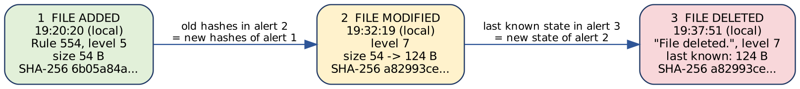

*Figure 12.1: The test file's lifecycle as seen by Wazuh. Each alert carries the previous state, so the three alerts form a chain.*

> **Key takeaway:** FIM proves *that* a file changed and *what* the change was, down to the hash. It does not by itself say *which process* changed it, so a FIM alert is a starting point that must be correlated with process evidence.

## 12.2 Why FIM matters to a SOC analyst

-   **Tampering:** modified system binaries (for example `cmd.exe`, `powershell.exe`, `schtasks.exe`, the same tools abused in Phases 3 and 4) can indicate an attacker or a corrupted system.
-   **Persistence:** files placed in a Startup folder can be configured to run at sign-in (MITRE ATT&CK T1547.001, Boot or Logon Autostart Execution: Registry Run Keys / Startup Folder). A file's location alone does not show that it runs or that it is malicious.
-   **Evidence integrity:** hashes let an analyst show that a file is exactly the one that was recorded, and detect a silent change.
-   **Compliance:** the alerts carry PCI DSS, NIST 800-53, GDPR, HIPAA and TSC tags (visible in Figure 12.7).

## 12.3 FIM configuration review

The Windows agent's local configuration was inspected with `Select-String` on `C:\Program Files (x86)\ossec-agent\ossec.conf`.

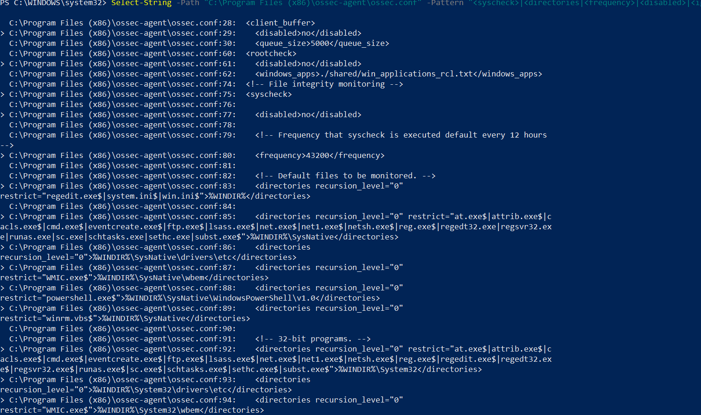

*Figure 12.2: Start of the syscheck block: the section opens at line 75 with FIM enabled (`<disabled>no</disabled>`, line 77) and a scan frequency of 43200 seconds, 12 hours (line 80). Lines 83 to 94 list the monitored Windows directories.*

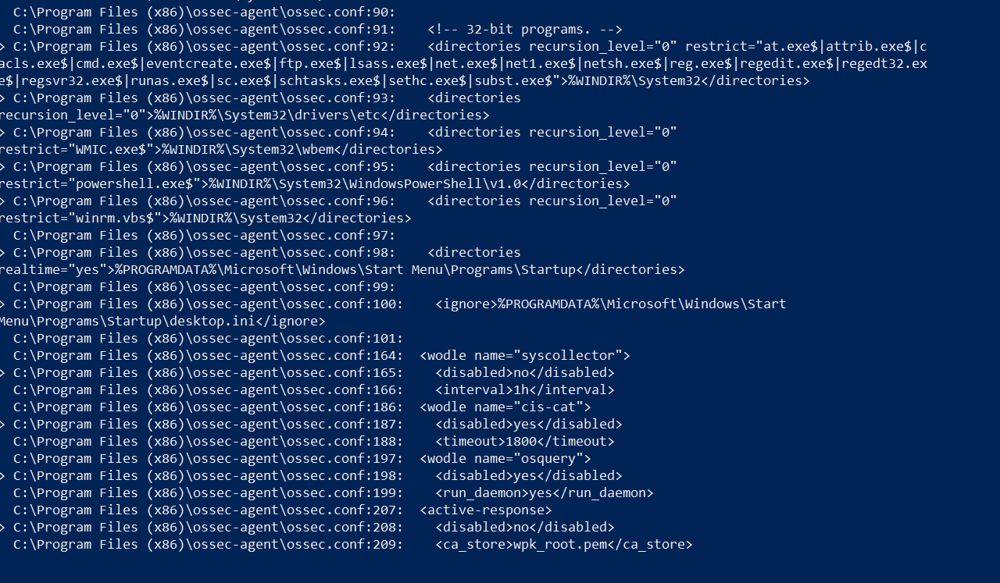

*Figure 12.3: Rest of the monitored paths. Line 98 monitors the user Startup folder with realtime="yes"; line 100 ignores `desktop.ini` there. Lines 164 onward show other modules (syscollector enabled, CIS-CAT and osquery disabled, active response enabled).*

| **Setting** | **Observed value** | **Meaning** |
|---|---|---|
| FIM module | `<disabled>no</disabled>` | Enabled |
| Scheduled scan | `<frequency>43200</frequency>` | A full scan every 12 hours |
| Windows system directories | `%WINDIR%`, `System32`, `SysNative`, `drivers\etc`, `wbem`, `WindowsPowerShell\v1.0` | Watched, with a `restrict` list of sensitive file names (for example `cmd.exe`, `schtasks.exe`, `powershell.exe`, `reg.exe`, `net.exe`) |
| Startup folder | `%PROGRAMDATA%\Microsoft\Windows\Start Menu\Programs\Startup`, `realtime="yes"` | Watched **in real time** |
| Excluded file | `...\Startup\desktop.ini` | Ignored to reduce noise |

**What the configuration implies.**

-   Only the Startup folder is real time. A change to a system binary such as `schtasks.exe` is found at the **next scheduled scan**, which can be up to 12 hours later. That is a detection-speed trade-off an analyst must know about.
-   The restricted file names are exactly the Windows tools used in earlier phases. FIM watches whether those programs are *altered*, while Sysmon (Phases 3 and 4) watches when they are *run*. The two views complement each other.
-   The same file also shows `<client_buffer>` enabled with a queue of 5000 events (lines 29 and 30). A buffer holds events when the agent cannot reach the manager. This is relevant background to the delayed archive records in Sections 9.2 and 10.5, but it is **not** evidence of their cause.

The Startup folder was therefore the natural place for a controlled test: it is monitored in real time and relevant to persistence.

## 12.4 Test design

A harmless text file was created in the monitored folder, modified once, then deleted:

    C:\ProgramData\Microsoft\Windows\Start Menu\Programs\Startup\wazuh-fim-test.txt

| **Step** | **Action** | **Time (local)** | **Wazuh alert** |
|---|---|---|---|
| 1 | Create the file (54 bytes) | 19:20:19 | "File added to the system.", rule 554, level 5, at 19:20:20.070 |
| 2 | Verify the SHA-256 with PowerShell | shortly after | n/a (independent check) |
| 3 | Append one line (file grows to 124 bytes) | 19:32:19 | Modified, level 7, at 19:32:19.558 |
| 4 | Delete the file | not timestamped in the screenshot | "File deleted.", level 7, at 19:37:51.941 |

The file is a `.txt` and does not execute. A real Startup-folder persistence attempt would place an executable, script or shortcut there; this test only exercises the detection path.

## 12.5 Test 1: file creation

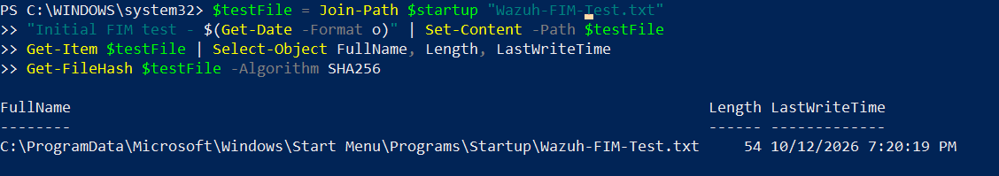

*Figure 12.4: Creating the test file: `Set-Content` writes one line, `Get-Item` shows length 54 and LastWriteTime 7:20:19 PM, and `Get-FileHash` is called to fingerprint it.*

Wazuh raised the alert about one second after the file's write time:

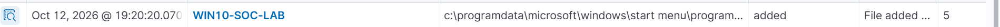

*Figure 12.5: Wazuh Discover row: 12 Oct 2026 19:20:20.070, agent WIN10-SOC-LAB, the Startup path, event "added", "File added ...", level 5.*

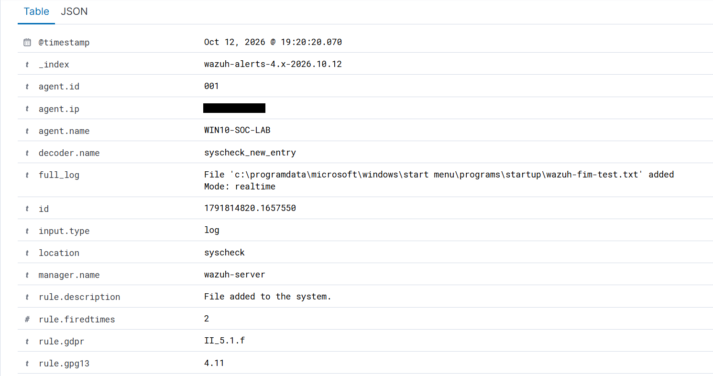

*Figure 12.6: Alert details, upper part: index `wazuh-alerts-4.x-2026.10.12`, agent 001, decoder `syscheck_new_entry`, location `syscheck`, manager `wazuh-server`, description "File added to the system.", full log "File ... added, Mode: realtime".*

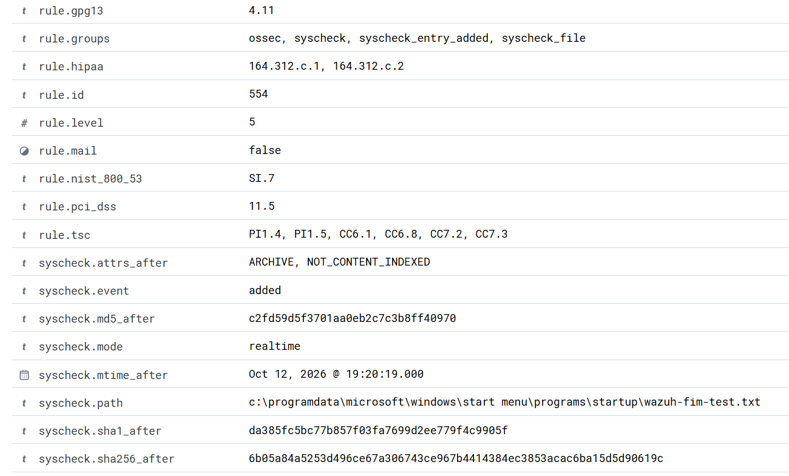

*Figure 12.7: Alert details, rule fields: rule ID 554, level 5, groups `ossec, syscheck, syscheck_entry_added, syscheck_file`, compliance tags (GDPR, GPG13, HIPAA, NIST 800-53 SI.7, PCI DSS 11.5, TSC), `syscheck.event: added`, mode realtime, the file path, mtime 19:20:19, and the MD5, SHA-1 and SHA-256 values.*

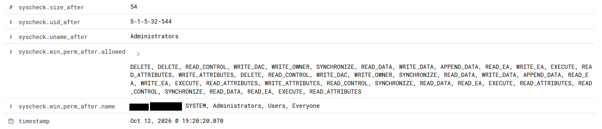

*Figure 12.8: Alert details, file attributes: size 54 bytes, owner SID S-1-5-32-544 (Administrators), the Windows permission list and the alert timestamp. User names in the permission list are blacked out for publication.*

| **Field** | **Value in the alert** |
|---|---|
| Rule / level | 554 / 5, "File added to the system." |
| Decoder / mode | `syscheck_new_entry` / realtime |
| Size | 54 bytes |
| Modification time | 12 Oct 2026 19:20:19 |
| Owner | Administrators (S-1-5-32-544) |
| MD5 | `c2fd59d5...ff40970` |
| SHA-1 | `da385fc5...c9905f` |
| SHA-256 | `6b05a84a5253d496ce67a306743ce967b4414384ec3853acac6ba15d5d90619c` |

**Hash verification.** The same file was fingerprinted with PowerShell:

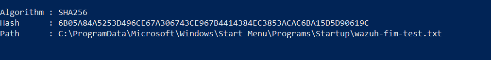

*Figure 12.9: `Get-FileHash -Algorithm SHA256` on the test file returns 6B05A84A...5D90619C, the same value Wazuh recorded in the file-added alert (hex is case-insensitive).*

The two SHA-256 values are identical, so the file's content at verification time matched the fingerprint stored in the original event. As a size check, the first line is 19 characters of text plus a 33-character ISO timestamp plus a 2-byte line break, which is 54 bytes, the size Wazuh recorded.

> **Key takeaway:** an independent tool and the Wazuh alert agree on the same SHA-256, so the alert can be trusted as a faithful record of the file.

## 12.6 Test 2: file modification

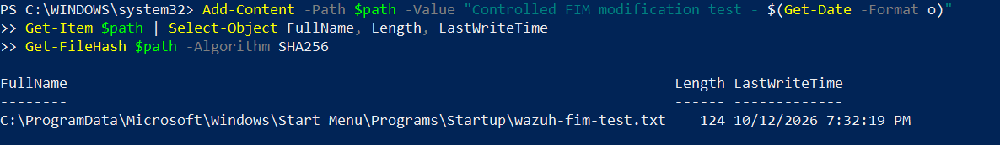

*Figure 12.10: Appending a line with `Add-Content`, then `Get-Item` shows length 124 and LastWriteTime 7:32:19 PM.*

*Figure 12.11: Wazuh Discover row: 12 Oct 2026 19:32:19.558, event "modified", description beginning "Integrity ch...", level 7.*

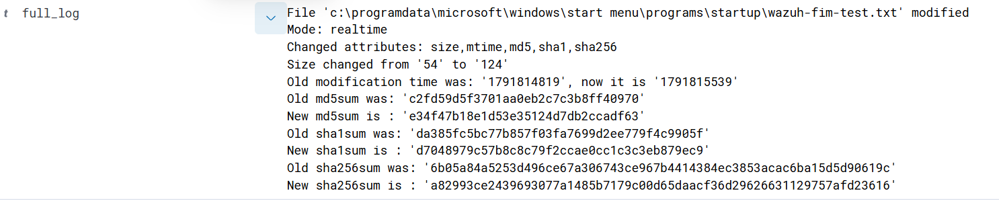

*Figure 12.12: Full log of the modification alert: mode realtime; changed attributes size, mtime, md5, sha1, sha256; size changed from 54 to 124; old and new modification times; old and new MD5, SHA-1 and SHA-256.*

| **Attribute** | **Before** | **After** |
|---|---|---|
| Size | 54 bytes | 124 bytes (+70) |
| Modification time | 1791814819 = 19:20:19 local | 1791815539 = 19:32:19 local (12 minutes later) |
| MD5 | `c2fd59d5...ff40970` | `e34f47b1...ccadf63` |
| SHA-1 | `da385fc5...c9905f` | `d7048979...b879ec9` |
| SHA-256 | `6b05a84a...5d90619c` | `a82993ce...afd23616` |

**Cross-checks that passed.**

-   The "before" hashes in the modification alert are exactly the "after" hashes of the file-added alert (Figure 12.7 against Figure 12.12). The baseline chain is unbroken.
-   The size grew by 70 bytes, which equals the appended text (35 characters, a 33-character timestamp and a 2-byte line break). The new size matches `Get-Item` (124).
-   The epoch times convert to 19:20:19 and 19:32:19 local, matching the PowerShell write times and a 12-minute gap.

**What is not independently verified.** The new SHA-256 (`a82993ce...`) is taken from Wazuh's alerts and was not re-computed with a second tool, so it rests on Wazuh alone. The deletion alert repeats the same value (next section), but that is Wazuh again, not a second tool.

The rule ID of the modification and deletion alerts is not visible in the screenshots (the rows show only the description and level 7). Wazuh's standard FIM rules for these events are 550 (checksum changed) and 553 (file deleted); this should be confirmed in Discover before the IDs are quoted.

## 12.7 Test 3: file deletion

The notes asked that deletion be recorded only after its alert had been verified. The alert was captured, so it is recorded here.

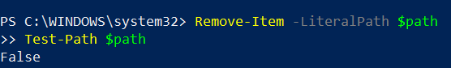

*Figure 12.13: Deleting the file with `Remove-Item -LiteralPath $path`; `Test-Path $path` returns False.*

*Figure 12.14: Wazuh Discover row: 12 Oct 2026 19:37:51.941, event "deleted", "File deleted.", level 7.*

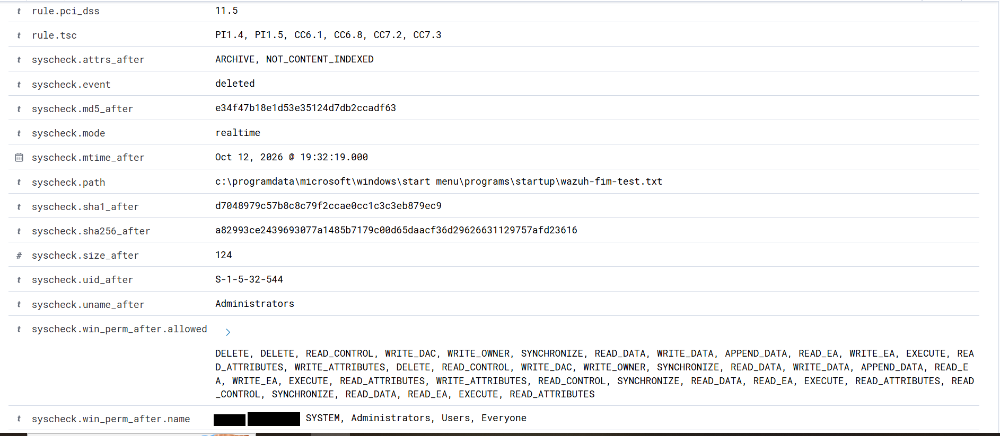

*Figure 12.15: Alert details for the deletion: `syscheck.event: deleted`, mode realtime, and the **last known** attributes of the file: size 124, modification time 19:32:19, MD5 `e34f47b1...`, SHA-1 `d7048979...`, SHA-256 `a82993ce...`. User names in the permission list are blacked out for publication.*

The deleted file's last known size, modification time and all three hashes equal the **after** values of the modification alert. The three alerts therefore form one consistent chain: added (54 bytes), modified (124 bytes), deleted (last state 124 bytes). `Test-Path` returning False shows the file really was gone, independent of Wazuh.

## 12.8 Existing alert on the SYSTEM account: inconclusive

Before the controlled tests, an older FIM alert was reviewed. Its available details were:

| **Detail** | **Value** |
|---|---|
| User / SID | `SYSTEM` / S-1-5-18 |
| Size | 219 bytes |
| Last modified | 19 March 2019 |
| Hashes and permissions | MD5, SHA-1, SHA-256 and a Windows permission list |
| File path | **not available** in the details supplied |
| Change type (added, modified, deleted) | **not available** |

**Verdict: inconclusive.** Without the path and the change type, the alert cannot be called benign or malicious. The `SYSTEM` account and the permissions do not decide it: legitimate Windows servicing runs as `SYSTEM`, and so would an attacker with high privileges. A modification time of 2019 describes the file's content timestamp, not when the change happened.

**How the case could be closed.** Search Discover for the alert (user `SYSTEM`, size 219) and read `syscheck.path` and `syscheck.event`. Then check whether the path is a normal Windows component, compare the hash with a trusted reference, look at what else happened on the host at that time (Sysmon Event 11 file creation and Event 1 process creation for the same minute), and check whether a patch or installation was running. If none of this is possible, record the alert as an evidence gap.

## 12.9 Analysis of the controlled test

**Verdict for the test: benign, controlled lab activity.** All three alerts match actions the author performed, with consistent times, sizes and hashes.

**What FIM showed well:** the exact event (added, modified, deleted), size and timestamp changes, before-and-after hashes, and the file owner and permissions, all within about a second in real-time mode.

**What FIM did not show.** None of the captured fields identifies the **process or user that made the change**. In this evidence the alert shows the file's owner (Administrators), not the program that wrote it. Attribution would need one of: Wazuh's who-data monitoring (not enabled in the configuration reviewed), or correlation with Sysmon Event 11 (file creation) and Event 1 (process creation) using the time window, as practised in Phase 4. Checking Event 11 for `wazuh-fim-test.txt` around 19:20:19 is a planned follow-up, not something done in this phase.

**Limits of the test.** A text file does not execute. Only the Startup folder was tested in real time; system binaries are checked every 12 hours, so a change there would be reported late. A real attacker could also place a file outside the monitored directories.

## 12.10 Detection improvements (proposed, not deployed)

1.  **Severity by file type.** A new `.exe`, `.bat`, `.cmd`, `.ps1`, `.vbs` or `.lnk` in the Startup folder is far more interesting than a text file. A custom rule built on the file-added rule (554) could raise those to a higher level. The rule below is a **sketch**: the field name and pattern must be validated against a real Windows FIM alert and with `wazuh-analysisd -t` before use.

        <rule id="100110" level="10">
          <if_sid>554</if_sid>
          <field name="file" type="pcre2">(?i)\\start menu\\programs\\startup\\.+\.(exe|bat|cmd|ps1|vbs|lnk)$</field>
          <description>Executable or script added to a Startup folder</description>
          <mitre><id>T1547.001</id></mitre>
          <group>syscheck,persistence,startup_folder,</group>
        </rule>

2.  **Faster coverage of sensitive binaries.** Consider real-time monitoring for the directories holding the restricted file names, accepting the extra load, or shortening the 12-hour scan interval.
3.  **Attribution.** Enable who-data monitoring for the Startup folder, or build a documented correlation step with Sysmon Event 11.
4.  **Noise control.** Keep an ignore list (like `desktop.ini`) for known benign Startup entries, and review it periodically.

## 12.11 Phase 10 status and lessons

| **Item** | **Status** |
|---|---|
| FIM configuration reviewed | Complete (Figures 12.2, 12.3) |
| File creation detected and hash verified | Complete (Figures 12.5 to 12.9) |
| File modification detected | Complete; new hash not independently verified |
| File deletion detected | Complete (Figures 12.13 to 12.15) |
| Existing SYSTEM alert (219 bytes) | **Inconclusive** |
| Process attribution of the file changes | **Not established** (planned) |

**Lessons**

1.  A FIM alert proves a change, not intent, and not which process caused it.
2.  Verify what the tool reports with an independent tool (here, `Get-FileHash`), and keep track of what was *not* independently verified.
3.  Each alert carries the previous state, so a sequence of FIM alerts can be checked for consistency like a chain of custody.
4.  Real-time and scheduled monitoring differ in detection delay; know which applies to the path you care about.
5.  An alert without its path and change type is inconclusive. Record it as such instead of guessing.

**Portfolio principle:** every finding is tied to a screenshot or an arithmetic check; what could not be verified is written down as such.
