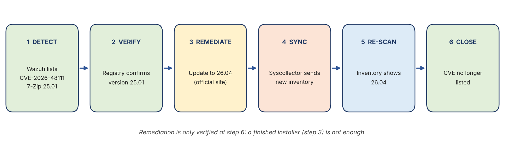
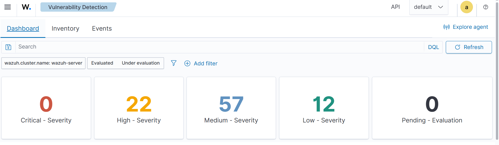
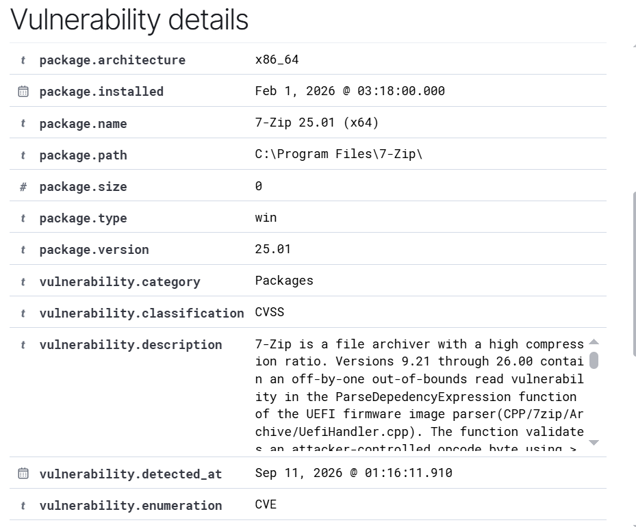
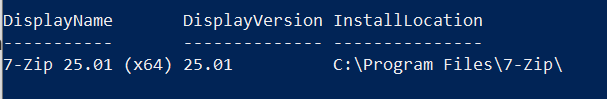
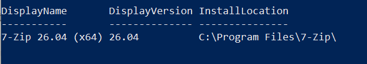
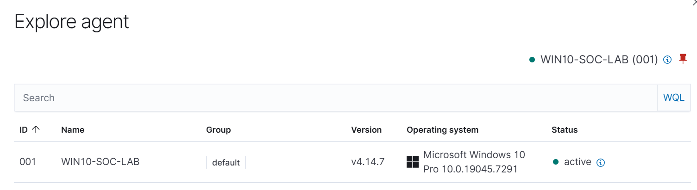
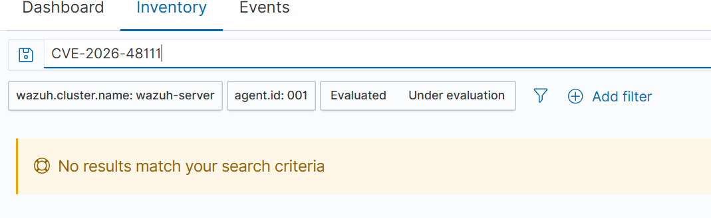
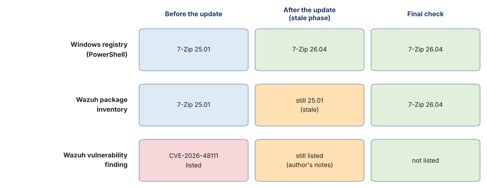

# 13. Phase 11: Vulnerability Detection and Remediation

Earlier phases looked at what *happens* on the endpoint: processes, logons, network connections and file changes. Vulnerability detection asks a different question: **what weaknesses exist on the endpoint before anything happens?** Wazuh compares the software inventory reported by the agent with a database of known vulnerabilities (CVEs) and lists every installed package whose version is affected. This phase takes one High-severity finding from the dashboard, proves what it means, fixes it, and then checks that Wazuh agrees the problem is gone. A stale inventory record delayed that last step, so the phase also records how the discrepancy was investigated. The work was done on 13 October 2026. Times in this section are **local time, UTC+5**, unless stated.

## 13.1 Phase 11 at a glance

| **Question** | **Evidence** | **Answer** |
|---|---|---|
| What does Wazuh report for the endpoint? | Dashboard counts (Figure 13.2) | **91 findings**: 0 Critical, 22 High, 57 Medium, 12 Low |
| Which software does the chosen finding affect? | Finding details (Figure 13.3) | **7-Zip 25.01 (x64)**, `CVE-2026-48111` |
| Is the software really installed in that version? | PowerShell registry query (Figure 13.4) | **Yes**, 25.01, in `C:\Program Files\7-Zip\` |
| Was it fixed? | Registry query after the update (Figure 13.5) | **Yes**, 26.04 |
| Did Wazuh follow immediately? | Package inventory (Figure 13.6) | **No**: the inventory still showed 25.01 for a while |
| Was the agent healthy? | Agent panel (Figure 13.7), log and connectivity checks in the notes | **Active**; earlier connection errors found in the agent log |
| Is the finding closed? | Inventory and CVE search (Figures 13.8, 13.9) | **Yes**: inventory shows 26.04 and the CVE is no longer listed |



*Figure 13.1: The vulnerability workflow practised in this phase. Remediation counts as verified only at the last step, when the scanner itself no longer lists the finding.*

> **Key takeaway:** a vulnerability finding is a **weakness**, not an **incident**. The job is to confirm it, fix it and prove the fix, without confusing "version matches a CVE" with "the host was attacked".

## 13.2 How Wazuh finds vulnerabilities, and why the inventory matters

The agent's Syscollector module collects the list of installed software (and other inventory data) and sends it to the manager. The Vulnerability Detection module then matches package names and versions against vulnerability content, in this case the National Vulnerability Database as stated in the author's notes, and shows each match with a CVE ID, a CVSS score and the fixed version.

Two practical consequences follow, and both showed up in this phase:

-   **The scanner is only as current as the inventory.** If the inventory still says 25.01, the scanner keeps reporting 25.01 even when Windows already has 26.04 (Section 13.7).
-   **A match is a version comparison, not a test.** Nothing was exploited and nothing was proved about the host; the scanner only found a version that falls inside the vulnerable range.

(This paragraph describes how the module works in general. What was *observed* in this lab is shown in the figures that follow.)

## 13.3 Step 1: the findings overview



*Figure 13.2: Vulnerability Detection dashboard: 0 Critical, 22 High, 57 Medium, 12 Low and 0 Pending evaluation. The filter bar shows the cluster `wazuh-server` and the Evaluated / Under evaluation switch; no agent filter is applied.*

| **Severity** | **Findings** |
|---|---|
| Critical | 0 |
| High | 22 |
| Medium | 57 |
| Low | 12 |
| Pending evaluation | 0 |
| **Total** | **91** (equal to the 91 records in the author's notes) |

The dashboard in Figure 13.2 is not filtered to agent 001. The lab has had a single endpoint throughout this document, so the counts are treated as that endpoint's; adding an `agent.id: 001` filter would confirm it.

The author opened one High finding to learn what the data contains and what a fix involves. Choosing one finding and following it end to end is the realistic way to work: 91 findings cannot all be fixed in one sitting, and the first decision is *which one to take first* (Section 13.10).

## 13.4 Step 2: reading one finding



*Figure 13.3: Details of the chosen finding (upper part): package 7-Zip 25.01 (x64), type `win`, path `C:\Program Files\7-Zip\`, package version 25.01, category Packages, classification CVSS, enumeration CVE, detected on 11 Sep 2026 at 01:16:11.910. The description reads "7-Zip is a file archiver with a high compression ratio. Versions 9.21 through 26.00 contain an off-by-one out-of-bounds read vulnerability in the ParseDependencyExpression function of the UEFI firmware image parser ..." and is cut off in the screenshot.*

| **Field** | **Value** | **Source** |
|---|---|---|
| CVE ID | `CVE-2026-48111` | Author's notes and the search box in Figure 13.9 |
| Severity | High | Author's notes; consistent with the dashboard's High tile |
| CVSS base score and version | 7.1, CVSS 3.1 | Author's notes (not visible in Figure 13.3) |
| Affected software | 7-Zip 25.01 (x64) | Figure 13.3 |
| Installed path | `C:\Program Files\7-Zip\` | Figure 13.3 |
| Vulnerable condition | Package version below 26.01 | Author's notes; the description in Figure 13.3 gives the range 9.21 to 26.00 |
| Fixed version | 26.01 | Author's notes |
| First detected | 11 Sep 2026, 01:16:11.910 | Figure 13.3 |
| Data source | National Vulnerability Database | Author's notes |

**What the vulnerability is.** According to the record, an off-by-one out-of-bounds read exists in the code that parses UEFI firmware images, and processing a specially crafted firmware image could cause a denial of service or limited information disclosure (author's notes).

**Reading the detection date.** The finding was first recorded on 11 September 2026, earlier than the documented phases, which began in October. So the finding already existed in Wazuh before it was investigated here. The timestamp shows when Wazuh matched the package, not when 7-Zip was installed or exploited.

**Initial assessment.** The installed version fell inside the vulnerable range. That is all the finding establishes. It does not show that an attacker used the flaw, and it does not show that the endpoint is compromised.

## 13.5 Step 3: verifying the installed version

Before changing anything, the version was checked with a source independent of Wazuh, the Windows uninstall registry:

```powershell
Get-ItemProperty `
  'HKLM:\SOFTWARE\Microsoft\Windows\CurrentVersion\Uninstall\*',
  'HKLM:\SOFTWARE\WOW6432Node\Microsoft\Windows\CurrentVersion\Uninstall\*' |
  Where-Object { $_.DisplayName -like '*7-Zip*' } |
  Select-Object DisplayName, DisplayVersion, InstallLocation
```



*Figure 13.4: Before the update: `7-Zip 25.01 (x64)`, version 25.01, `C:\Program Files\7-Zip\`. Windows and Wazuh agree on the vulnerable version.*

Both uninstall hives are queried because a 64-bit program normally registers in the first one and a 32-bit program in the second; checking both avoids missing the package.

## 13.6 Step 4: remediation

7-Zip was updated from the official site (https://www.7-zip.org/) and the same query was repeated:



*Figure 13.5: After the update: `7-Zip 26.04 (x64)`, version 26.04, same install location. 26.04 is newer than the fixed version 26.01 named in the finding.*

The local check proves that **Windows** now reports 26.04. It does not yet prove that **Wazuh** knows. The remediation was therefore not treated as verified until the Wazuh inventory and the vulnerability state had been checked.

## 13.7 Step 5: the finding stayed after the fix

After the update, `CVE-2026-48111` was still listed in Wazuh (recorded in the lab notes). This is a normal and instructive situation: the endpoint and the SIEM disagreed, and the analyst has to find out why instead of assuming either side is right.

**5a. What does the Wazuh inventory say?** Under IT Hygiene, Software Packages, Wazuh still showed the old package:


*Figure 13.6: Wazuh package inventory still listing `7-Zip 25.01 (x64)`, version 25.01, for `WIN10-SOC-LAB`, publisher Igor Pavlov, type `win`, while the Windows registry already reported 26.04.*

The scanner was working from this stale record, which explains why the finding was still listed. It does not yet explain why the record was stale.

**5b. Is the inventory collection switched on?** The agent's `ossec.conf` contains:

```xml
<wodle name="syscollector">
  <disabled>no</disabled>
  <interval>1h</interval>
  <scan_on_start>yes</scan_on_start>
</wodle>
```

Syscollector is enabled, runs hourly and also scans when the agent starts. So the configuration is not the problem. In theory a stale record should clear within about an hour once the agent can report.

**5c. Did the module run?** The agent log was searched:

```powershell
Get-Content -Path 'C:\Program Files (x86)\ossec-agent\ossec.log' -Tail 500 |
  Select-String -Pattern 'syscollector|inventory'
```

```text
2026/10/13 13:57:52 wazuh-modulesd:syscollector: INFO: Module started.
2026/10/13 13:57:52 wazuh-modulesd:syscollector: INFO: Starting evaluation.
2026/10/13 13:58:17 wazuh-modulesd:syscollector: INFO: Evaluation finished.
```

Syscollector started and finished an evaluation (25 seconds). That shows the endpoint-side collection ran. It does not show that the result reached the manager. A "Module started" line is written when the module starts, which normally happens when the agent service starts; the notes do not say whether the agent was restarted manually, so what triggered this run is **not established**.

**5d. Was the agent connected?** The same log also contained connection errors:

```text
ERROR: Unable to connect to '[<manager-ip>]:1514/tcp'
WARNING: Unable to connect to any server.
ERROR: Lost connection with manager.
WARNING: Process locked due to agent is offline.
```

So at some point the agent could not reach the manager, and inventory results could not be delivered while it was offline. The manager side and the network path were then checked:

| **Check** | **Command** | **Result** |
|---|---|---|
| Manager service | `sudo systemctl status wazuh-manager --no-pager -l` | Active and running |
| Port listening | `sudo ss -lntp \| grep ':1514'` | Port 1514 listening |
| Path from Windows | `Test-NetConnection <manager-ip> -Port 1514` | `TcpTestSucceeded : True` |
| Agent state (server) | `sudo /var/ossec/bin/agent_control -lc` | Agent 001 `WIN10-SOC-LAB` Active |



*Figure 13.7: Dashboard agent panel: `WIN10-SOC-LAB (001)`, group `default`, version v4.14.7, Microsoft Windows 10 Pro 10.0.19045.7291, status **active**. This is the dashboard view of the agent state; the `agent_control -lc` result listed above is recorded in the lab notes.*

**What can be concluded.** The agent had connection problems earlier; at the time of the checks the manager was running, the port was open, the path from Windows worked and the agent was active. The connection errors are a **plausible** reason for the stale record (the new inventory could not be delivered while the agent was offline), but they are **not proved** to be the only cause. Nothing in the evidence timestamps the errors against the update, so the cause of the stale record remains a hypothesis (open item 10).

## 13.8 Step 6: the inventory catches up and the finding closes

After the inventory refreshed, Software Packages showed the new version:


*Figure 13.8: Wazuh package inventory now listing `7-Zip 26.04 (x64)`, version 26.04, the same value Windows reports (Figure 13.5).*

Returning to Vulnerability Detection and searching for the CVE gave:



*Figure 13.9: Vulnerability Detection, Inventory tab, search `CVE-2026-48111` with filters cluster `wazuh-server`, `agent.id: 001` and Evaluated / Under evaluation: "No results match your search criteria."*

This is the verification the phase was aiming for: the software was updated, Wazuh's inventory reflects it, and the specific finding is gone. An empty result is meaningful here only because the earlier steps showed the finding *was* listed and because the search ran against the same agent and filters. Searching a mistyped CVE ID would also return nothing.



*Figure 13.10: The same package seen from three places over time. The amber cells mark the stale phase: Windows already said 26.04 while Wazuh still reported 25.01. The "still listed" cell comes from the author's notes, not from a screenshot.*

## 13.9 Analysis

**Verdict: remediated and verified in the lab. The finding was a vulnerable-version match, not an incident.**

| **Verification item** | **Result** | **Evidence** |
|---|---|---|
| Original version identified | 25.01 | Figures 13.3, 13.4 |
| Updated version verified locally | 26.04 | Figure 13.5 |
| Syscollector enabled | Confirmed | `ossec.conf` (lab notes) |
| Syscollector evaluation completed | Confirmed | Agent log lines (notes) |
| Manager running, port 1514 listening | Confirmed | Command output (notes) |
| Windows to manager TCP connectivity | Successful | `Test-NetConnection` (notes) |
| Agent status | Active | Figure 13.7 |
| Wazuh inventory updated | Confirmed | Figure 13.8 |
| `CVE-2026-48111` listed at the final check | **No** | Figure 13.9 |

**What the evidence shows.** The installed 7-Zip was inside the vulnerable range, it was updated to a version outside that range, and Wazuh's inventory and vulnerability view both reflect the update.

**What it does not show.**

-   It does not show that every vulnerability on the endpoint is resolved. 90 other findings were not touched.
-   It does not show that the host was clean. A vulnerability scanner reports weaknesses, not compromise.
-   It does not prove why the inventory was stale (Section 13.7).
-   It does not show how long the delay lasted; the intermediate states carry no times.

**Exposure reasoning (judgment, not tested).** Per the description, the flaw is triggered by processing a specially crafted UEFI firmware image. An attacker would have to get such a file to the user and have 7-Zip open it, and the stated impact is a denial of service or limited information disclosure. On a single-user lab machine that rarely handles firmware images, practical risk is therefore lower than the High label suggests, but the fix is cheap, so updating was the right call.

## 13.10 Proposed improvements (not deployed)

1.  **Triage the remaining findings before fixing any.** Sort the 22 High findings by package, mark which software is actually used, and fix the exposed and widely used ones first (browsers, archivers, PDF readers, runtimes) before the rarely used ones.
2.  **Keep a short remediation record per finding:** CVE, package, version before and after, date, who fixed it, and which dashboard view confirmed closure. Figure 13.10 is a template for that record.
3.  **Always verify with two sources.** Check the host (registry or `Get-Package`) and the SIEM (inventory and finding). When they disagree, check the agent state and the manager connection before concluding anything.
4.  **Do not wait for the hourly scan when a fix is urgent.** Restarting the agent service triggers a Syscollector scan because `scan_on_start` is `yes`. This is a configuration-based expectation that was not tested here.
5.  **Watch agent connectivity as part of detection health.** An agent that is offline sends no inventory, no alerts and no FIM events, so a connection error in the agent log is a finding in its own right.

## 13.11 Phase 11 status and lessons

| **Item** | **Status** |
|---|---|
| Findings overview captured | Complete (Figure 13.2) |
| One High finding investigated | Complete (Figure 13.3) |
| Installed version verified before and after | Complete (Figures 13.4, 13.5) |
| Stale inventory investigated | Complete; **cause not established** |
| Agent health checked | Complete |
| Remediation verified in Wazuh | Complete (Figures 13.8, 13.9) |
| Remaining 90 findings | Not triaged |

**Lessons**

1.  A vulnerability finding is a weakness, not proof of exploitation.
2.  Verify the installed version with an independent source before and after the fix.
3.  A finished installer is not a finished remediation: the scanner has to stop reporting the finding.
4.  A stale SIEM record is not the same as an unfixed host. Check the inventory, then the agent, then the connection.
5.  Connection errors in a log make a good hypothesis, not a proved cause, unless their timing matches.
6.  An empty search result is only evidence when the same search showed the finding earlier.

**Portfolio value:** this phase shows a complete vulnerability-management cycle (find, confirm, fix, verify) and the troubleshooting needed when the SIEM lags behind the endpoint.
